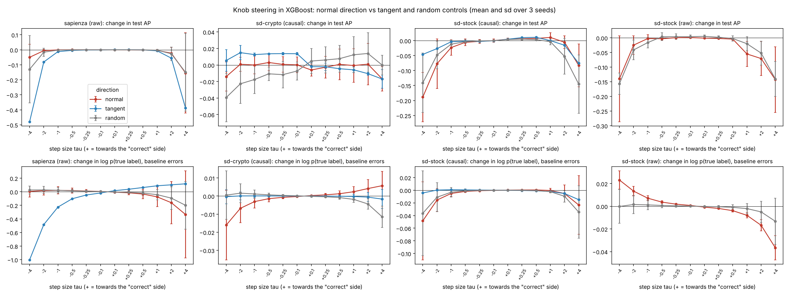

# Knob 方法迁移到 XGBoost 的异常检测实验 · 中文 v1

版本:CN v1(2026-11-24)。英文版见 [KNOB_XGB_REPORT_EN_v1.md](KNOB_XGB_REPORT_EN_v1.md)。

## 结论

**Knob 方法迁移到 XGBoost 后,没有带来可靠的检测提升。** 三项任务、三个种子上,测试 AP 的变化都在种子间波动之内;“旋钮”方向的干预效果与随机方向、切向方向没有区别。

- 唯一方向一致的迹象在 Sapienza:漏报从 9.7 个降到 8.7 个(共 77 个异常),F1 从 0.910 升到 0.919,但 AP 没变,样本量只有一两个异常,不能当作结论。
- SD-FMM 加密货币上验证集选出的配置反而让测试漏报从 31.7 增到 35.0。
- 原因在机制上:XGBoost 的输出就是各阶段贡献的直接求和,隐状态里没有输出之外的“多余信息”可供旋钮利用。详见“Knob 如何影响检测”。

范围:只做了 Sapienza 15S、SD-FMM 股票、SD-FMM 加密货币三项。IBM TabFormer 没有做(数据准备需要约 7 GB 内存和序列模型,本次环境放不下)。

## 方法:论文 → XGBoost 的对应

论文(Huang、Mao、Jiang、Cambria,*Uncovering the Knowledge Boundaries and Mechanistic "Knob" of LLMs*)在 LLM 最后一个提示词位置的隐状态 H ∈ ℝ^{L×d} 上学一个“答对 / 答错”边界,发现少数几个维度(旋钮)就够,再沿边界法向推这几个维度,正确答案的似然上升,而切向和随机方向不行。

| 论文 | 本实验 |
| --- | --- |
| 隐状态 H(x) ∈ ℝ^{L×d} | 分阶段贡献图:把提升树按顺序分成 L=8 段,H[ℓ,j] = 第 ℓ 段的树对特征 j 的 TreeSHAP 贡献。margin = 偏置 + Σ H,已数值核对 |
| 标签“回答正确” | XGBoost 的报警决定是否正确(TP/TN 对,FN/FP 错),在训练序列上用分组交叉拟合(out-of-fold)得到 |
| 多视图 CNN 探针,LR / MLP 对照 | 相同(纵向、横向、局部三个分支),核尺寸按 L、d 缩小 |
| 粗到细找旋钮:s_j = Σ_ℓ\|ΔA_ℓj\|,取最小的 k 使 Acc(J_k) ≥ Acc_full − 1% | 相同;另加同样大小的随机特征子集对照 |
| 旋钮空间里的层注意力 + KAN | 相同(k-2-1 的 RBF-KAN);没有做符号蒸馏 |
| 干预:Δz̄ = τ/(‖∇Φ‖+ε)·d,最小范数分层补丁 | 相同;XGBoost 对每段都是加法读出,所以 margin 的变化 = 补丁之和。方向:法向、切向、随机 |

论文没有、为了给方法一个公平机会而加的两种用法:

- **边界门控**:按旋钮边界判断“当前决定是错的”的概率,把分数往阈值另一侧推。
- **边界引导重训**:边界判为“错误侧”的训练样本加权,重新训练 XGBoost。

对照:只用 margin 及其到阈值的距离的探针(不确定性对照)、随机旋钮、按 margin 不确定性加权的重训。

协议:探针、旋钮、KAN 只用训练序列;τ、λ 和用哪种用法在验证集上按 AP 选(基线本身也是候选);测试标签只用一次。基线与仓库 [Knob](https://github.com/SansaZheng/Knob) 里记录的 XGBoost 逐种子完全一致(AP、TP、FP 全部相同)。

## 实验结果

测试集,三个种子(42、13、2026)均值 ± 样本标准差。“Knob-XGBoost”是每个种子在验证集上选出的配置。

| 任务(特征) | 方法 | AP | F1 | 漏报 FN | 误报 FP |
| --- | --- | ---: | ---: | ---: | ---: |
| Sapienza 15S(raw,77 个异常) | XGBoost | 0.9650 ± 0.0026 | 0.910 ± 0.008 | 9.7 | 3.7 |
| | Knob-XGBoost | 0.9649 ± 0.0029 | 0.919 ± 0.001 | 8.7 | 3.3 |
| SD-FMM 加密货币(causal,68 个异常) | XGBoost | 0.6571 ± 0.0139 | 0.609 ± 0.007 | 31.7 | 15.0 |
| | Knob-XGBoost | 0.6533 ± 0.0142 | 0.602 ± 0.010 | 35.0 | 8.7 |
| SD-FMM 股票(raw,99 个异常点) | XGBoost | 0.6019 ± 0.0148 | 0.617 ± 0.011 | 39.7 | 34.0 |
| | Knob-XGBoost | 0.6058 ± 0.0073 | 0.615 ± 0.015 | 41.0 | 31.7 |
| SD-FMM 股票(causal) | XGBoost | 0.4685 ± 0.0471 | 0.462 ± 0.020 | 53.3 | 53.3 |
| | Knob-XGBoost | 0.4656 ± 0.0515 | 0.457 ± 0.032 | 56.7 | 43.7 |

逐种子的测试 AP 差(Knob − 基线):Sapienza −0.0010 / 0 / +0.0008;加密货币 −0.0001 / +0.0045 / −0.0161;股票 raw 0 / +0.0132 / −0.0015。没有一项方向一致。

**细微异常(基线漏掉的那些)**:Sapienza 上基线共漏 29 个(三个种子合计),Knob 配置找回 3 个、没有丢失已抓到的;加密货币和股票上一个都没找回,反而分别丢了 10 个和 4–10 个已抓到的。报警数量固定为基线水平时的召回率:Sapienza 0.874 → 0.879,加密货币 0.534 → 0.520,股票 raw 0.599 → 0.603。

各用法单独看(每种用法在验证集上取最好配置,相对基线的测试 AP 变化,均值 ± 标准差):

| 用法 | Sapienza | 加密货币 | 股票 causal |
| --- | ---: | ---: | ---: |
| 法向干预(论文原法) | +0.0000 ± 0.0004 | −0.0039 ± 0.0108 | +0.0110 ± 0.0142 |
| 随机方向干预(对照) | +0.0001 ± 0.0002 | +0.0042 ± 0.0156 | +0.0041 ± 0.0029 |
| 边界门控 | −0.0001 ± 0.0002 | −0.0084 ± 0.0367 | −0.0017 ± 0.0133 |
| 边界引导重训 | −0.0017 ± 0.0029 | −0.0326 ± 0.0294 | +0.0095 ± 0.0210 |
| 按 margin 不确定性重训(对照) | −0.0033 ± 0.0006 | −0.0015 ± 0.0270 | +0.0010 ± 0.0260 |



## Knob 如何影响检测

**1. 边界能学出来,但信息量不超过 margin 本身。** 分组交叉验证的平衡准确率(随机水平 0.50):

| | Sapienza | 加密货币 | 股票 causal |
| --- | ---: | ---: | ---: |
| 完整 H,CNN 探针 | 0.818 | 0.754 | 0.531 |
| 旋钮(top-k 特征) | 0.855 | 0.749 | 0.573 |
| 随机同样大小的特征子集(均值) | 0.790 | 0.748 | 0.534 |
| 只用 margin 与到阈值距离(对照) | **0.953** | **0.829** | **0.577** |

在 LLM 里,隐状态比输出的一个 token 含有多得多的信息,所以探针能看出“模型其实不知道”。XGBoost 的 margin 就是 H 的求和,H 里几乎没有 margin 之外关于对错的信息。股票子集上边界基本学不出来。

**2. 旋钮不稳定,也不特异。** Sapienza 三个种子里两个得到单一旋钮 `std_volume`,第三个没有紧凑集合(k=13,即全部特征);加密货币三个种子分别是 k=1(`std16`)、3、7。随机挑一个特征,最好的能到 0.91–0.93,高于旋钮的 0.84–0.88。在测试集上判断基线对错,旋钮 KAN 的平衡准确率 0.735,随机旋钮 0.807(Sapienza,每个种子只有 12–14 个错误)。论文里随机 2 维子集没有一个追上旋钮,这里不成立。

**3. 法向干预没有论文中的特异效应。** 论文的关键证据是法向有效、切向和随机无效。这里以基线判错样本上真实标签的对数似然变化衡量:Sapienza 上 τ=−1 时法向 +0.021,随机方向 +0.022,两者相同;加密货币上法向为 −0.003,符号相反且接近零。步长大到 |τ|=4 时,Sapienza 上任何方向都只是在破坏排序,AP 下降 0.05–0.48。

**4. 往“正确侧”推,在 XGBoost 里等于让模型更坚持当前决定。** 边界只知道“像不像会判错”,不知道真实标签。LLM 里推完之后由后面的层决定输出;XGBoost 没有后续计算,推贡献就是直接改分数。Sapienza 上的符号与这个解释一致:正向 τ 让判错样本更错(τ=+1 时判错样本对数似然 −0.075),负向略有改善但随机方向也一样。这是对结果的解释,没有单独做实验验证。

**5. 重训用法改变的是精确率与召回率的取舍,不是排序质量。** Sapienza 上边界引导重训让漏报平均减少 1.3 个(三个种子都减少)、误报增加 0.7 个,AP 反而降 0.002;股票上它让误报减少 16 个、漏报增加 6 个;加密货币上三个种子方向不一。这是阈值附近的移动,不是新增的识别能力。

## 局限

- 每项任务的错误样本很少(Sapienza 训练集交叉拟合只有约 30 个错误),探针和旋钮排序的方差大。
- 特征维度只有 7–13 维(股票 raw 只有 1 维),论文是在 4096 维里找 2 维,这里“少数维度”的说法本身意义有限。
- 交叉拟合的模型与最终模型不是同一个,它们的贡献图有差别;这一差别对结果的影响没有单独测量。
- KAN 没有做符号蒸馏;CNN 输入按格子标准化而不是论文的 LayerNorm。
- TabFormer 没有做。

## 复现

```bash
pip install numpy pandas scikit-learn xgboost torch matplotlib
for d in sapienza sd-stock sd-crypto; do python -m baselines.knob_xgb --dataset $d; done
python -m baselines.knob_xgb --dataset sd-stock --variant raw
python -m baselines.knob_aggregate
```

2 核 CPU、8 GB 内存,全部运行约 40 分钟。全部结果重跑一次,数字完全一致;从保存的分数独立重算 24 组指标,全部吻合(`results/knob/audit.csv`)。
