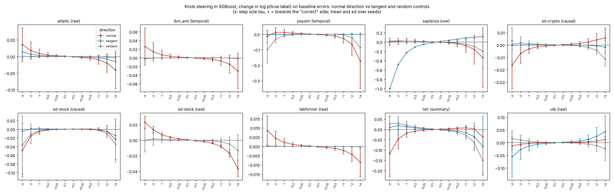
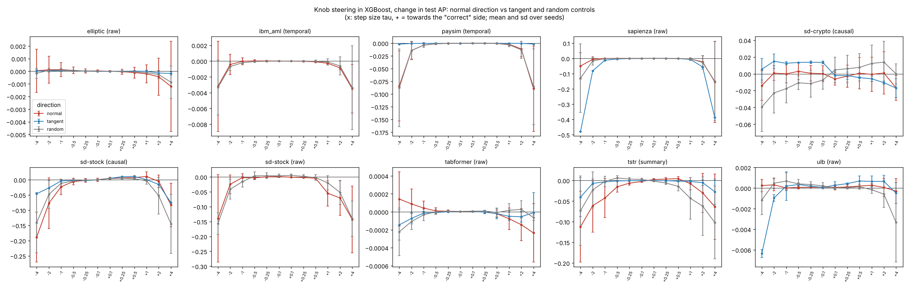

# Knob-XGBoost 与 Kronos_SupervisedAD 的对比实验 · 中文 v2

版本:CN v2(2026-11-24)。英文版见 [KNOB_XGB_REPORT_EN_v2.md](KNOB_XGB_REPORT_EN_v2.md)。上一版 [CN v1](KNOB_XGB_REPORT_CN_v1.md) 只有三项行情任务;本版扩到 [Kronos_SupervisedAD](https://github.com/SansaZheng/Kronos_SupervisedAD) 的全部九项公开任务,并与该仓库的方法同表比较。

## 结论

1. **XGBoost 在九项任务中的六项明显高于已记录的 Kronos-mini,一项持平,两项低于它。** 高于:Sapienza、SD-FMM 加密货币、TSTR、Elliptic、PaySim、IBM AML。持平:ULB。低于:SD-FMM 股票(0.602 对 0.630,Kronos 只有单种子)和 TabFormer(两者 AP 都低于 0.01,都不可用)。
2. **Knob 仍然没有带来可靠的检测提升。** 九项任务里 Knob-XGBoost 相对 XGBoost 的测试 AP 变化在 −0.004 到 +0.015 之间,三个种子都为正的只有 Elliptic(+0.003),TabFormer 三个种子都为负。有提升的地方,按普通不确定性加权重训的对照也有同样大小的提升。
3. **新发现:在特征较多的交易表数据上,旋钮确实存在并且是特异的,只是不转化为检测收益。** Elliptic、PaySim、IBM AML、TabFormer 上,旋钮特征明显强于随机特征,法向干预能改变判错样本的似然而随机方向不能,这两点与论文一致,v1 的行情数据上没有。但边界信息仍不超过分数本身,排序几乎不变。

Kronos 的数字全部取自该仓库的记录,本次没有重跑(需要 GPU 和预训练权重)。IEEE-CIS 原始数据不随仓库分发,没有做。

## 做法

- **数据与划分**:直接调用 Kronos_SupervisedAD 自己的数据准备代码(同样的 seed 42、50 万 / 10 万的训练 / 验证上限、完整测试段),所以训练行、验证行、测试行与它的 Kronos 运行相同。九项任务的测试行数和正类数与该仓库记录逐项一致。
- **特征**:每项任务试两种——当前观测的原始特征(raw),和该仓库梯度提升对照所用的设计(temporal:当前值、一步变化、对过去 4/16/64 个观测均值的偏离)。按 XGBoost 三个种子的平均验证 AP 选一种。TSTR 是整段分类,用整段摘要特征。
- **比较对象**:Kronos-mini R0(最初版本)、Kronos-mini 修复版(该仓库多轮改进后选中的方案)、该仓库的 HistGradientBoosting 对照(本次按其设置重跑)、XGBoost、Knob-XGBoost。
- **Knob-XGBoost** 的做法同 v1:分阶段贡献图作为隐状态,学“判对 / 判错”边界,找旋钮,做法向干预、边界门控、边界引导重训,在验证集上按 AP 选配置。
- 阈值都在验证集上按 F1 选定。XGBoost 系列为三个种子(42、13、2026)均值 ± 样本标准差。

为了在 2 核 CPU 上跑完,三项大数据(PaySim、IBM AML、TabFormer)和 Elliptic 的子集探针用 MLP+LR 而不是 CNN,CNN 改为小批量训练;三项大数据的重训只试两个权重、随机子集取 5 个。TabFormer 只用 raw 特征,HistGradientBoosting 对照在它上面没有跑(内存不够)。

## 与 Kronos_SupervisedAD 方法的比较

测试集 AP / F1。

| 任务(测试正类数) | Kronos-mini R0 | Kronos-mini 修复版 | HistGB 对照 | XGBoost | Knob-XGBoost |
| --- | ---: | ---: | ---: | ---: | ---: |
| Sapienza 15S(77) | 0.752 / 0.701 | 0.912 / 0.857 | 0.954 / 0.904 | **0.965 ± 0.003** / 0.910 | 0.965 ± 0.003 / 0.919 |
| SD-FMM 股票(99) | 0.578 / 0.609 | **0.630** / 0.590 | 0.443 / 0.432 | 0.602 ± 0.015 / 0.617 | 0.606 ± 0.007 / 0.615 |
| SD-FMM 加密货币(68) | 0.357 / 0.403 | 0.480 / 0.431 | 0.648 / 0.581 | **0.657 ± 0.014** / 0.609 | 0.653 ± 0.014 / 0.602 |
| TSTR(94) | 0.488 / 0.654 | 0.486 / 0.654 | 0.826 / 0.785 | 0.830 ± 0.023 / 0.756 | **0.836 ± 0.011** / 0.767 |
| ULB 信用卡(52) | 0.317 / 0.366 | 0.754 ± 0.010 / 0.784 | **0.776** / 0.826 | 0.755 ± 0.031 / 0.764 | 0.770 ± 0.004 / 0.786 |
| Elliptic(408) | 0.277 / 0.323 | 0.435 / 0.501 | **0.542** / 0.569 | 0.537 ± 0.004 / 0.562 | 0.540 ± 0.002 / 0.567 |
| PaySim(4,010) | 0.041 / 0.003 | 0.452 ± 0.197 / 0.120 | **0.975 ± 0.001** / 0.885 | 0.924 ± 0.058 / 0.754 | 0.931 ± 0.062 / 0.787 |
| IBM AML(1,567) | 0.071 / 0.162 | 0.266 / 0.348 | 0.242 ± 0.012 / 0.345 | 0.330 ± 0.002 / 0.421 | **0.332 ± 0.003** / 0.422 |
| TabFormer(4,454) | 0.0014 / 0.002 | **0.0074 ± 0.0008** / 0.011 | 未跑 | 0.0052 ± 0.0007 / 0.010 | 0.0044 ± 0.0011 / 0.007 |

Kronos 修复版带 ± 的三项是该仓库的三种子确认记录,其余是单种子(42)。完整表(含精确率、召回率和未选中的特征版本)见 `results/kronos_compare/comparison.csv`。

读这张表要注意:

- **TSTR 上 Kronos 的 AP 约等于正类比例(0.48)**,即没有学到东西;树模型用六个整段摘要特征就到 0.83。
- **PaySim 上 XGBoost 的种子间波动很大**(0.859–0.972)。验证集只有 33 个正类,早停轮数在 13 到 132 棵树之间跳动。HistGradientBoosting 对照固定 100 轮、不早停,反而最稳最高。
- **TabFormer 上所有方法都不可用。** 这里的特征只有单笔交易字段,没有按卡的历史。此前 Knob 仓库里加了按卡历史聚合和序列嵌入的 XGBoost 是 0.078,那是不同的特征,不能放进这张表比较。
- **ULB 上三者(Kronos 修复版、XGBoost、HistGB)基本持平**,测试集只有 52 个正类。

## Knob 对检测的影响

测试 AP 的变化(Knob-XGBoost − XGBoost),三个种子均值 ± 标准差,以及漏报变化:

| 任务 | ΔAP | ΔF1 | 基线漏报 | 找回 / 丢失 |
| --- | ---: | ---: | ---: | ---: |
| Elliptic | +0.0032 ± 0.0014 | +0.004 | 223 | 1.7 / 1.0 |
| IBM AML | +0.0019 ± 0.0041 | +0.001 | 1,130 | 9.0 / 8.3 |
| PaySim | +0.0064 ± 0.0109 | +0.033 | 1,543 | 234 / 46 |
| ULB | +0.0147 ± 0.0281 | +0.022 | 15.7 | 1.3 / 0.3 |
| TSTR | +0.0058 ± 0.0141 | +0.011 | 21.7 | 4.0 / 3.7 |
| Sapienza | −0.0001 ± 0.0009 | +0.009 | 9.7 | 1.0 / 0 |
| SD-FMM 股票 | +0.0039 ± 0.0081 | −0.003 | 39.7 | 0 / 1.3 |
| SD-FMM 加密货币 | −0.0039 ± 0.0108 | −0.007 | 31.7 | 0 / 3.3 |
| TabFormer | −0.0008 ± 0.0005 | −0.003 | 4,430 | 0 / 7.0 |

“找回 / 丢失”是基线漏掉后被 Knob 配置抓到的异常数,和基线抓到后被 Knob 配置漏掉的异常数。

**PaySim 和 ULB 的提升各来自一个种子,原因是基线早停过早。** PaySim 种子 13 的基线只训练了 32 棵树,重训后漏报从 1,670 降到 1,093;ULB 种子 2026 的基线只有 4 棵树,重训后 AP 从 0.720 升到 0.767。另外两个种子几乎不变。

**这些提升不是旋钮特有的。** 各用法相对基线的测试 AP 变化:

| 用法 | Elliptic | IBM AML | PaySim | ULB | TSTR | TabFormer |
| --- | ---: | ---: | ---: | ---: | ---: | ---: |
| 法向干预(论文原法) | +0.0004 | −0.0001 | −0.0007 | +0.0007 | −0.0073 | +0.0001 |
| 随机方向干预(对照) | +0.0000 | −0.0006 | −0.0015 | −0.0009 | +0.0000 | +0.0000 |
| 边界门控 | +0.0006 | −0.0007 | −0.0089 | −0.0371 | −0.0006 | +0.0001 |
| 边界引导重训 | +0.0012 | +0.0035 | +0.0424 | +0.0129 | +0.0012 | −0.0015 |
| 按分数不确定性重训(对照) | +0.0038 | +0.0047 | +0.0301 | +0.0094 | +0.0055 | −0.0011 |
| 随机旋钮重训(对照) | +0.0024 | +0.0027 | +0.0030 | +0.0088 | +0.0029 | −0.0006 |

论文原法(法向干预)的 AP 变化除 TSTR(−0.007)外都不超过 0.001。有用的只有重训,而按分数不确定性加权的普通重训效果相同或更好。

## 旋钮本身:交易表数据上是存在的

判对 / 判错边界的分组交叉验证平衡准确率(随机水平 0.50):

| 任务(特征数) | 完整贡献图最好探针 | 旋钮 | 随机同大小子集 | 只用分数(对照) |
| --- | ---: | ---: | ---: | ---: |
| Elliptic(94) | 0.691 | 0.702 | 0.637 | **0.907** |
| IBM AML(220) | 0.677 | 0.712 | 0.576 | **0.779** |
| PaySim(50) | 0.788 | 0.873 | 0.745 | **0.921** |
| TabFormer(42) | 0.763 | 0.765 | 0.690 | **0.812** |
| ULB(30) | 0.616 | 0.660 | 0.609 | **0.739** |
| TSTR(6) | 0.556 | 0.537 | 0.529 | **0.680** |

- **旋钮很少且比较稳定。** IBM AML 三个种子都只要 1 个特征(两次是 `log_gap_seconds-mean4`);PaySim 两个种子是同一个特征(`category_type_TRANSFER-mean4`);TabFormer 三个种子都是同两三个商户类别(MCC 4829、5300、5311);Elliptic 两个种子以 `local_3` 为首。ULB 和 TSTR 不稳定。
- **旋钮是特异的。** 上表四项大任务里旋钮都高于随机子集;在测试集上判断基线对错,旋钮边界的平衡准确率也高于随机旋钮(Elliptic 0.670 对 0.579,IBM AML 0.631 对 0.530,PaySim 0.783 对 0.625,TabFormer 0.604 对 0.435)。
- **法向干预有方向特异性。** τ=−1 时判错样本真实标签对数似然的变化:Elliptic 法向 +0.0093、随机 +0.0004;IBM AML +0.0070、−0.0001;PaySim +0.0124、−0.0095;TabFormer +0.0021、0.0000。这是论文的关键证据形式,在这四项上成立。
- **但符号与论文的用法相反,而且不改变排序。** 有利的是负向 τ,即把样本推离“正确侧”。往“正确侧”推会让判错的样本更错。同一步干预对判对的样本作用相反,所以整体 AP 的变化不超过 0.001。
- **边界信息仍不超过分数本身。** 每一项上,只看分数及其到阈值距离的对照都高于完整贡献图。





## 局限

- Kronos 数字是该仓库的记录,多数为单种子;硬件、训练预算与本次的树模型不同。
- Kronos 读的是 160 步窗口里的原始特征,树模型读的是同一窗口上手工构造的时间特征,输入信息相同但形式不同。
- 大数据和宽表上的探针设置比 v1 轻(见“做法”),这几项的探针准确率与 v1 的三项行情任务不完全可比。
- PaySim、ULB、SD-FMM、Sapienza 的验证集正类只有 33–67 个,早停和配置选择都受其影响。
- TabFormer 没有跑 HistGradientBoosting 对照和 temporal 特征。IEEE-CIS 没有做。
- “往正确侧推会让判错样本更错”的机制解释与各任务上的符号一致(SD-FMM 加密货币、SD-FMM 股票 causal、TSTR、ULB 除外,这几项效应接近零或符号相反),没有另做实验验证。

## 复现

```bash
pip install numpy "pandas<3" scikit-learn xgboost torch matplotlib huggingface_hub einops safetensors
git clone https://github.com/SansaZheng/Kronos_SupervisedAD && cd Kronos_SupervisedAD
export PYTHONPATH=/path/to/XGBoos:.
for d in tstr elliptic ulb paysim ibm_aml sd-stock sd-crypto sapienza; do
  python -m baselines.kronos_data --dataset $d --work /scratch/prep
  (cd /path/to/XGBoos && python -m baselines.kronos_compare --dataset $d --flat /scratch/prep/$d/flat --hgb)
done
python -m baselines.kronos_data --dataset tabformer --variants raw --work /scratch/prep
cd /path/to/XGBoos
python -m baselines.kronos_compare --dataset tabformer --flat /scratch/prep/tabformer/flat
export KNOB_TORCH_THREADS=2
python -m baselines.knob_xgb --dataset tstr --variant summary --flat /scratch/prep/tstr/flat
for d in ulb elliptic tabformer; do python -m baselines.knob_xgb --dataset $d --variant raw --flat /scratch/prep/$d/flat; done
for d in paysim ibm_aml; do python -m baselines.knob_xgb --dataset $d --variant temporal --flat /scratch/prep/$d/flat; done
python -m baselines.knob_aggregate && python -m baselines.kronos_table
```

必须用 pandas 2.x:pandas 3 的时间戳精度不同,该仓库的 IBM AML 和 TabFormer 时间划分会出错。三项行情任务的命令见 v1。2 核 CPU、8 GB 内存,新增六项约 3 小时。从保存的分数独立重算 60 组指标,全部吻合(`results/knob/audit.csv`)。
