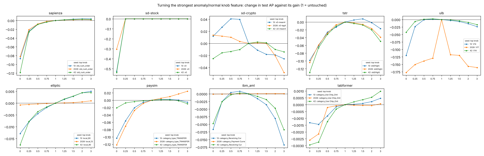
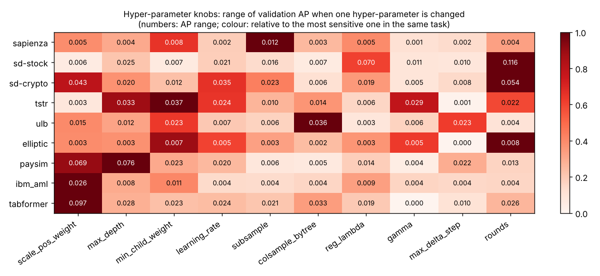

# 哪些 XGBoost 参数控制异常 / 正常的区别,以及调节它们的效果 · 中文 v3

版本:CN v3(2026-11-25)。英文版见 [KNOB_XGB_REPORT_EN_v3.md](KNOB_XGB_REPORT_EN_v3.md)。本版是在 [CN v2](KNOB_XGB_REPORT_CN_v2.md) 之上的增补:v2 的旋钮针对“判对 / 判错”边界,本版改为“异常 / 正常”边界,并且真正去调这些旋钮。数据、划分和基线与 v2 完全相同(Kronos_SupervisedAD 的九项任务)。

“XGBoost 参数”有两种读法,两种都做了:

- **模型内部的参数**:训练好的模型里,哪些特征的贡献、哪一段提升树承载两类的区别(第一部分)。
- **训练超参数**:哪些超参数决定两类的可分程度(第二部分)。

## 结论

1. **模型内部:控制异常 / 正常区别的旋钮很清楚,通常只有一个特征,但调它没有用。** 九项任务中七项只需一个特征就能复现完整的异常 / 正常边界,而且跨种子稳定。把这些旋钮的增益调大或调小,测试 AP 的变化在 −0.012 到 +0.016 之间,和调随机特征没有区别;验证集选出的增益大多就是 1(不动)。
2. **超参数:真正起作用的旋钮是 `scale_pos_weight`。** 它在四项任务上是最敏感的超参数。调最敏感的两个超参数后,三项任务三个种子全部提升:PaySim(AP 0.924 → 0.967,漏报 1,543 → 1,053)、SD-FMM 股票(0.602 → 0.651,误报 34 → 18)、TabFormer(0.0052 → 0.0078,仍不可用)。
3. **超参数调节不是处处有效。** Sapienza 三个种子全部下降(0.965 → 0.955),TSTR 略降,其余四项在种子波动之内。
4. **SD-FMM 股票调后超过了已记录的 Kronos-mini 修复版**(0.651 ± 0.003 对 0.630)。v2 中 XGBoost 低于 Kronos 的两项里,现在只剩 TabFormer 持平(0.0078 对 0.0074)。

## 第一部分:模型内部的旋钮

### 做法

- **隐状态**与 v1、v2 相同:提升树分成 8 段,H[ℓ,j] 是第 ℓ 段对特征 j 的 TreeSHAP 贡献,分数 = 偏置 + ΣH。
- **边界**改为异常 / 正常:在训练集上交叉拟合得到隐状态,取全部(最多 3,000 个)异常和 3,000 个正常样本,用 CNN、MLP、LR 探针预测标签。
- **旋钮**:按论文的粗到细方法给特征排序,取最少的 k 个特征使探针准确率不低于完整隐状态 1%。对照是同样大小的随机特征子集。
- **份额**:每个特征、每一段提升树承担了“异常平均分数 − 正常平均分数”这个差距的多少。
- **调节**:给旋钮一个增益 g,分数' = 分数 + (g−1) × 该特征(或该段)的贡献。对一段提升树的增益就是把这段树的叶子权重整体乘以 g,是对模型参数的直接改动。增益从 {0, 0.25, 0.5, 0.75, 1, 1.25, 1.5, 2, 3} 里按验证 AP 逐个贪心选取。对照是用同样方法调随机特征。

### 哪些参数控制两类的区别

三个种子的均值;“份额”是旋钮特征承担的分数差距比例。

| 任务(特征数) | 边界准确率 | 旋钮个数 | 旋钮特征(出现的种子数) | 旋钮 / 随机子集准确率 | 旋钮承担的差距份额 | 前半段树承担的份额 |
| --- | ---: | ---: | --- | ---: | ---: | ---: |
| Sapienza(13) | 0.985 | 1 | `std_rush_order`(3/3) | 0.994 / 0.962 | 0.76 | 0.58 |
| SD-FMM 股票(1) | 0.696 | 1 | 唯一特征 | 0.688 / — | 1.00 | 0.46 |
| SD-FMM 加密货币(7) | 0.940 | 1 | `x0-mean4`(2/3) | 0.948 / 0.929 | 0.41 | 0.64 |
| TSTR(6) | 0.718 | 4 | `std`、`last`、`last-first`(3/3) | 0.715 / 0.695 | 0.78 | 0.68 |
| ULB(30) | 0.932 | 2 | `V14`、`V10`、`V17`(各 2/3) | 0.927 / 0.834 | 0.53 | 0.62 |
| Elliptic(94) | 0.975 | 35 | 无紧凑集合(16–64 个) | 0.969 / 0.962 | 0.66 | 0.80 |
| PaySim(50) | 0.983 | 1.3 | `type=TRANSFER` 的一步变化(3/3) | 0.981 / 0.772 | 0.45 | 0.61 |
| IBM AML(220) | 0.796 | 1 | `Receiving Currency=Bitcoin` 的短期偏离(2/3) | 0.812 / 0.658 | 0.16 | 0.78 |
| TabFormer(42) | 0.852 | 1 | `Use Chip=Online Transaction`(3/3) | 0.857 / 0.681 | 0.44 | 0.68 |

- **异常 / 正常边界在隐状态里很容易学出来**,六项在 0.93 以上;SD-FMM 股票和 TSTR 在 0.70 左右,这两项本身也是最难的。
- **七项任务只要一个特征。** PaySim、IBM AML、TabFormer、ULB 上旋钮明显强于随机特征(差 0.09–0.21);Sapienza 和加密货币上差距小,因为那里多数特征都带有类别信息。
- **旋钮多数时候就是承担差距最多的那个特征**(27 次运行中 26 次排第一或第二)。例外是 IBM AML:旋钮只承担 16% 的差距,份额最大的是 `Payment Format=ACH`。
- **区别主要由前面的树建立。** 除 SD-FMM 股票外,前半段树承担 58%–80% 的分数差距。
- Elliptic 没有紧凑旋钮:类别信息分散在 16–64 个特征里。

### 调节这些旋钮的效果

测试 AP 相对基线的变化,三个种子均值 ± 标准差。

| 任务 | 调旋钮特征的增益 | 调随机特征的增益(对照) | 调各段树的增益 | 调旋钮后漏报变化 |
| --- | ---: | ---: | ---: | ---: |
| Sapienza | −0.0026 ± 0.0046 | −0.0017 | −0.0009 | +1.0 |
| SD-FMM 股票 | 0.0000 | — | +0.0015 | 0 |
| SD-FMM 加密货币 | +0.0018 ± 0.0016 | +0.0022 | −0.0022 | +0.7 |
| TSTR | −0.0119 ± 0.0134 | −0.0033 | −0.0027 | −2.0 |
| ULB | −0.0018 ± 0.0017 | −0.0006 | −0.0079 | 0 |
| Elliptic | +0.0163 ± 0.0115 | +0.0146 | +0.0035 | −4.3 |
| PaySim | +0.0027 ± 0.0061 | −0.0001 | +0.0080 | +12.7 |
| IBM AML | −0.0005 ± 0.0009 | +0.0001 | +0.0006 | +1.3 |
| TabFormer | +0.0001 ± 0.0001 | 0.0000 | +0.0004 | −0.3 |

- **调旋钮不改善检测。** 没有一项的提升超出种子波动并且高于随机对照。
- **验证集选出的增益大多是 1。** 27 次运行中,首个旋钮的增益有 13 次保持 1,其余除两次外都在 0.75–1.5 之间。也就是说训练已经把这些部分放在了接近最优的强度上。
- **Elliptic 的 +0.016 不是旋钮特有的**:调随机特征同样得到 +0.015。这项任务验证段与测试段差别很大(验证 AP 0.93,测试 0.54),重新缩放一批特征都会带来类似的变化。
- **调各段树的增益**(直接缩放叶子权重)在验证集上提升 0.003–0.023,到测试集上基本消失;8 个增益在几十个验证正类上拟合,是过拟合。唯一稍大的是 PaySim(+0.008,漏报 −52)。



## 第二部分:超参数旋钮

### 做法

以基线设置为中心,每次只改一个超参数(各取两个替代值),共 10 个超参数。一个超参数的敏感度定义为它引起的验证 AP 变化范围。取最敏感的两个联合搜索(3×3),按验证 AP 选定,再用三个种子重跑并与基线逐种子比较。扫描用种子 42。

基线:600 轮上限、早停 50 轮、学习率 0.05、深度 6、行采样 0.8、列采样 0.8、`min_child_weight` 1、`scale_pos_weight` = √(负 / 正)。

### 哪些超参数控制可分性

验证 AP 的变化范围;每行最敏感的两个加粗。

| 任务 | `scale_pos_weight` | `max_depth` | `min_child_weight` | 学习率 | 行采样 | 列采样 | `reg_lambda` | `gamma` | `max_delta_step` | 轮数 |
| --- | ---: | ---: | ---: | ---: | ---: | ---: | ---: | ---: | ---: | ---: |
| Sapienza | 0.005 | 0.004 | **0.008** | 0.002 | **0.012** | 0.003 | 0.005 | 0.001 | 0.002 | 0.004 |
| SD-FMM 股票 | 0.006 | 0.025 | 0.007 | 0.021 | 0.016 | 0.007 | **0.070** | 0.011 | 0.010 | **0.116** |
| SD-FMM 加密货币 | **0.043** | 0.020 | 0.012 | 0.035 | 0.023 | 0.006 | 0.019 | 0.005 | 0.008 | **0.054** |
| TSTR | 0.003 | **0.033** | **0.037** | 0.024 | 0.010 | 0.014 | 0.006 | 0.029 | 0.001 | 0.022 |
| ULB | 0.015 | 0.012 | **0.023** | 0.008 | 0.006 | **0.036** | 0.003 | 0.006 | 0.023 | 0.004 |
| Elliptic | 0.003 | 0.003 | **0.007** | 0.005 | 0.003 | 0.002 | 0.003 | 0.005 | 0.000 | **0.008** |
| PaySim | **0.069** | **0.076** | 0.023 | 0.020 | 0.006 | 0.005 | 0.014 | 0.004 | 0.022 | 0.013 |
| IBM AML | **0.026** | 0.008 | **0.011** | 0.004 | 0.004 | 0.004 | 0.009 | 0.004 | 0.004 | 0.004 |
| TabFormer | **0.097** | 0.028 | 0.023 | 0.024 | 0.021 | **0.033** | 0.020 | 0.000 | 0.011 | 0.026 |

- **`scale_pos_weight`(正类权重)是最常见的旋钮**:在加密货币、PaySim、IBM AML、TabFormer 四项上排前二,也是这几项里变化幅度最大的。它直接决定模型把多少分数差距分给异常类。
- **`min_child_weight` 在五项上排前二**,但幅度小。
- **训练轮数在 SD-FMM 两项和 Elliptic 上敏感**,基线的早停在这三项上都已是最好的选择。
- `gamma`、`max_delta_step` 几乎不起作用。



### 调节后的检测效果

测试集,三个种子均值 ± 标准差。

| 任务 | 调的超参数与选定值 | AP 基线 → 调后 | 提升的种子数 | F1 | 漏报 FN | 误报 FP |
| --- | --- | ---: | ---: | ---: | ---: | ---: |
| PaySim | `scale_pos_weight` = 负 / 正(深度不变) | 0.924 ± 0.058 → **0.967 ± 0.006** | 3/3 | 0.754 → 0.842 | 1,543 → 1,053 | 54 → 48 |
| SD-FMM 股票 | `reg_lambda` = 10(早停不变) | 0.602 ± 0.015 → **0.651 ± 0.003** | 3/3 | 0.617 → 0.663 | 39.7 → 41.0 | 34 → 18 |
| TabFormer | `scale_pos_weight` = 1、列采样 = 1 | 0.0052 → 0.0078 | 3/3 | 0.010 → 0.013 | 4,430 → 4,422 | 492 → 563 |
| IBM AML | `scale_pos_weight` = 1 | 0.330 ± 0.002 → 0.334 ± 0.004 | 2/3 | 0.421 → 0.425 | 1,130 → 1,119 | 69 → 92 |
| ULB | 列采样 = 0.5、`min_child_weight` = 20 | 0.755 ± 0.031 → 0.765 ± 0.005 | 1/3 | 0.764 → 0.776 | 15.7 → 14.0 | 6.7 → 8.0 |
| SD-FMM 加密货币 | `scale_pos_weight` = 负 / 正 | 0.657 ± 0.014 → 0.659 ± 0.009 | 1/3 | 0.609 → 0.600 | 31.7 → 30.0 | 15.0 → 20.7 |
| Elliptic | 基线已是最优,未改 | 0.537 → 0.537 | — | 不变 | 不变 | 不变 |
| TSTR | 深度 = 3、`min_child_weight` = 5 | 0.830 ± 0.023 → 0.826 ± 0.002 | 1/3 | 0.756 → 0.758 | 21.7 → 21.3 | 25.3 → 25.3 |
| Sapienza | 行采样 = 1 | 0.965 ± 0.003 → 0.955 ± 0.001 | 0/3 | 0.910 → 0.914 | 9.7 → 8.3 | 3.7 → 4.7 |

- **PaySim**:正类权重从 √比例 提到完整比例后,三个种子都提升,种子间波动也从 0.058 降到 0.006。v2 里 PaySim 的不稳定(早停轮数在 13 到 132 棵树之间跳动)由此基本消除。调后的 0.967 接近 Kronos_SupervisedAD 梯度提升对照的 0.975。
- **SD-FMM 股票**:更强的 L2 正则让误报减半,AP 超过已记录的 Kronos-mini 修复版(0.630)。这项只有一个特征、测试集 6 条序列。
- **Sapienza 是反例**:验证 AP 升了 0.0007,测试 AP 三个种子全降。验证集只有 50 个正类,这样小的验证提升不可信。
- **正类权重的方向因任务而异**:PaySim、加密货币要调大,IBM AML、TabFormer 要调小。没有一个通用的取值。

## 与 Kronos_SupervisedAD 的比较(更新)

测试 AP。Kronos 为该仓库记录,未重跑。

| 任务 | Kronos-mini 修复版 | XGBoost 基线 | XGBoost 调超参数后 |
| --- | ---: | ---: | ---: |
| Sapienza 15S | 0.912 | **0.965** | 0.955 |
| SD-FMM 股票 | 0.630 | 0.602 | **0.651** |
| SD-FMM 加密货币 | 0.480 | 0.657 | **0.659** |
| TSTR | 0.486 | **0.830** | 0.826 |
| ULB | 0.754 | 0.755 | **0.765** |
| Elliptic | 0.435 | **0.537** | 0.537 |
| PaySim | 0.452 | 0.924 | **0.967** |
| IBM AML | 0.266 | 0.330 | **0.334** |
| TabFormer | 0.0074 | 0.0052 | **0.0078** |

## 局限

- 超参数扫描只用了种子 42,每个超参数只试两个替代值,联合搜索只覆盖最敏感的两个。这是“哪些旋钮起作用”的排查,不是完整调参。
- 选择都在验证集上做,而多项任务的验证正类只有 33–100 个;Sapienza 的结果说明小幅验证提升可能在测试集上反向。
- 增益调节作用在 TreeSHAP 贡献上。对一段树的增益等于缩放叶子权重;对单个特征的增益是对读出的重新加权,不对应一组可独立缩放的叶子。
- 三项大数据和 Elliptic 的 CNN 探针用小批量训练,子集探针统一用 MLP+LR。
- Kronos 数字是记录值,多数为单种子。TabFormer 上所有方法仍不可用。

## 复现

数据准备同 v2。然后:

```bash
export KNOB_TORCH_THREADS=2
for d in sapienza sd-crypto; do python -m baselines.knob_params --dataset $d; done
python -m baselines.knob_params --dataset sd-stock --variant raw
python -m baselines.knob_params --dataset tstr --variant summary --flat /scratch/prep/tstr/flat
for d in ulb elliptic tabformer; do python -m baselines.knob_params --dataset $d --variant raw --flat /scratch/prep/$d/flat; done
for d in paysim ibm_aml; do python -m baselines.knob_params --dataset $d --variant temporal --flat /scratch/prep/$d/flat; done
python -m baselines.knob_params_aggregate
```

2 核 CPU、8 GB 内存,全部约 4 小时。逐次记录在 `results/knob_params/`。
