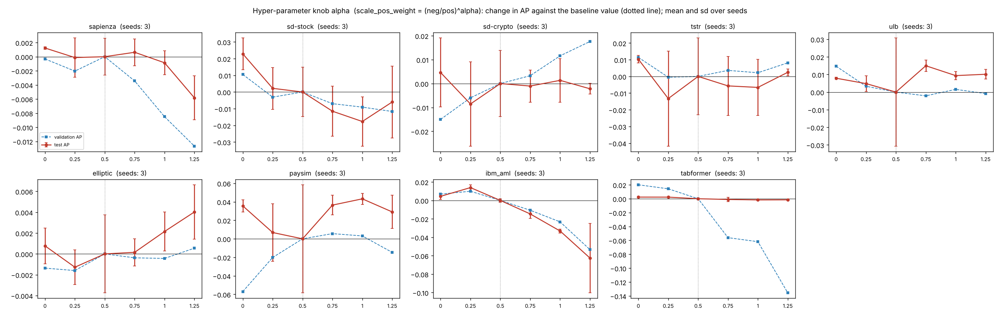
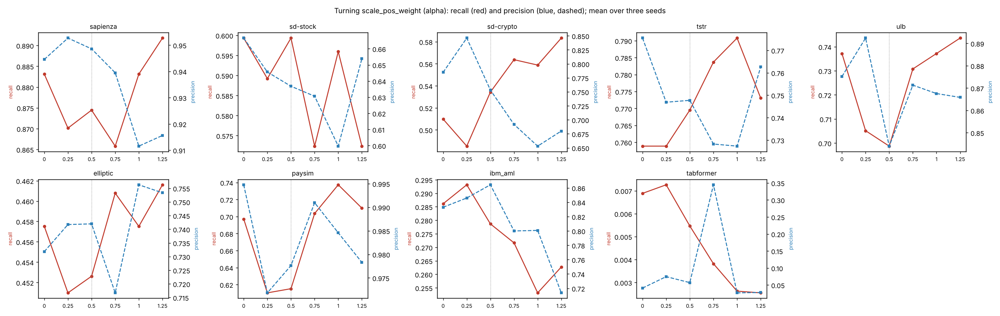
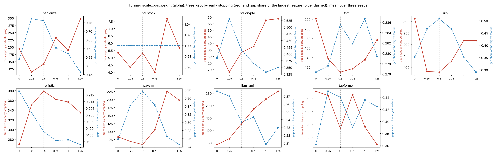
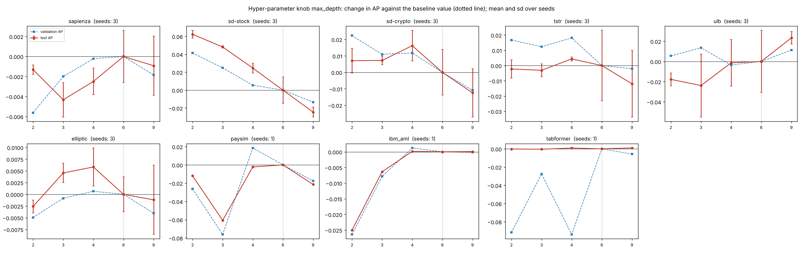
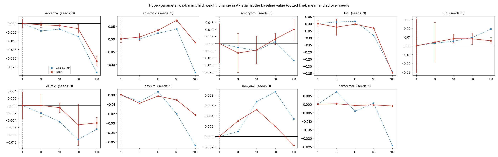
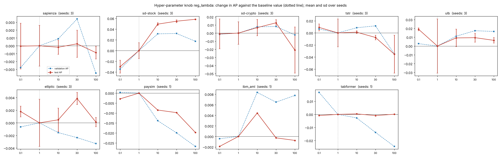

# 超参数旋钮的重点分析 · 中文 v4

版本:CN v4(2026-11-25)。英文版见 [KNOB_XGB_REPORT_EN_v4.md](KNOB_XGB_REPORT_EN_v4.md)。[CN v3](KNOB_XGB_REPORT_CN_v3.md) 发现真正能改变检测效果的是训练超参数,但只做了单种子、每个超参数两个替代值的粗扫。本版对四个超参数旋钮做细的剂量-反应分析:每个取 5–6 个值、三个种子,并记录每个取值下模型内部发生了什么。数据、划分、基线与 v2、v3 相同。

## 结论

1. **四个旋钮的作用取决于任务属于哪一类,没有通用的最优值。** 九项任务大致分成四类:小数据过拟合(SD-FMM 股票)、训练段与测试段分布不同(IBM AML、TabFormer)、早停不稳(PaySim、ULB、TSTR)、已饱和(Sapienza、Elliptic)。
2. **`scale_pos_weight`(正类权重)是影响面最广的旋钮,但方向因类而异。** IBM AML 上权重越小越好,而且是单调的(AP 从 0.344 降到 0.267);PaySim 上基线取值恰好落在最差的位置,往哪边调都更好;Sapienza、Elliptic 上几乎不动。
3. **基线的正类权重(√负正比)在三项任务上是种子间最不稳定的取值。** PaySim、ULB、TSTR 在这个取值下的种子间标准差是 0.023–0.058,把权重设为 1 后降到 0.0005–0.006。
4. **正类权重改变的是模型内部“差距由谁承担”。** 权重在基线附近时,异常与正常的分数差距最集中在一个特征上;权重更大时差距分散到更多特征和更多棵树上。IBM AML 上这种分散与测试 AP 下降同时出现。
5. **按验证集选一个旋钮的一个取值,九项任务的平均测试 AP 都没有下降**,其中四项三个种子全部提升:SD-FMM 股票 +0.062、IBM AML +0.014、SD-FMM 加密货币 +0.007、TabFormer +0.002。

## 做法

每次只动一个旋钮,其余保持基线(最多 600 轮、早停 50 轮、学习率 0.05、行列采样 0.8):

| 旋钮 | 取值(基线加粗) |
| --- | --- |
| 正类权重指数 α,`scale_pos_weight` = (负 / 正)^α | 0、0.25、**0.5**、0.75、1、1.25 |
| `max_depth` | 2、3、4、**6**、9 |
| `min_child_weight` | **1**、3、10、30、100 |
| `reg_lambda` | 0.1、**1**、10、30、100 |

α=0 即权重为 1(不加权),α=1 即完整的负正比。六项小任务每个取值跑三个种子;三项大任务(PaySim、IBM AML、TabFormer)的 α 跑三个种子,其余三个旋钮只跑种子 42。

每次训练记录:验证 / 测试 AP、F1、精确率、召回率、漏报、误报(阈值在验证集上按 F1 选);早停保留的树数;以及在验证行上用 TreeSHAP 得到的内部量——异常与正常的平均分数差距里,最大的那个特征占多少、等效有多少个特征在承担、前一半的树承担多少。

## 每个旋钮能把测试 AP 推动多少

一个旋钮所有取值下测试 AP 的变化范围。最后一列是基线下三个种子的标准差,范围要明显超过它才算真的在起作用。带 * 的是单种子。

| 任务 | 正类权重 α | `max_depth` | `min_child_weight` | `reg_lambda` | 基线种子间标准差 |
| --- | ---: | ---: | ---: | ---: | ---: |
| SD-FMM 股票 | 0.041 | **0.087** | **0.088** | **0.088** | 0.015 |
| IBM AML | **0.077** | 0.025* | 0.007* | 0.006* | 0.002 |
| PaySim | 0.043 | 0.061* | 0.021* | 0.020* | 0.058 |
| TSTR | 0.024 | 0.016 | **0.346** | 0.044 | 0.023 |
| ULB | 0.015 | 0.047 | 0.008 | 0.019 | 0.031 |
| SD-FMM 加密货币 | 0.013 | 0.029 | 0.017 | 0.034 | 0.014 |
| Sapienza | 0.007 | 0.004 | 0.022 | 0.001 | 0.003 |
| Elliptic | 0.005 | 0.008 | 0.005 | 0.004 | 0.004 |
| TabFormer | 0.004 | 0.001* | 0.001* | 0.001* | 0.001 |

TSTR 的 0.346 和 Sapienza 的 0.022 都来自 `min_child_weight` = 100 时模型变差(TSTR 只剩 1 棵树,Sapienza 的 AP 降到 0.943),不是可利用的调节空间。

## 重点一:正类权重

三个种子平均的测试 AP:

| 任务 | α=0 | 0.25 | **0.5(基线)** | 0.75 | 1 | 1.25 |
| --- | ---: | ---: | ---: | ---: | ---: | ---: |
| IBM AML | 0.334 | **0.344** | 0.330 | 0.315 | 0.297 | 0.267 |
| TabFormer | **0.0075** | 0.0075 | 0.0052 | 0.0041 | 0.0034 | 0.0036 |
| SD-FMM 股票 | **0.625** | 0.604 | 0.602 | 0.590 | 0.584 | 0.596 |
| PaySim | 0.960 | 0.931 | 0.924 | 0.961 | **0.967** | 0.953 |
| ULB | 0.763 | 0.760 | 0.755 | **0.770** | 0.764 | 0.765 |
| TSTR | **0.841** | 0.817 | 0.830 | 0.825 | 0.824 | 0.833 |
| SD-FMM 加密货币 | **0.662** | 0.649 | 0.657 | 0.656 | 0.659 | 0.655 |
| Sapienza | **0.966** | 0.965 | 0.965 | 0.966 | 0.964 | 0.959 |
| Elliptic | 0.537 | 0.535 | 0.537 | 0.537 | 0.539 | **0.541** |



**分布不同的任务:权重越小越好。** IBM AML 上测试 AP 随 α 单调下降,验证 AP 的排序与测试完全一致(秩相关 1.0),三个种子的结论相同。TabFormer 也是 α ≤ 0.25 最好。这两项都是按时间划分、验证与测试差距大的任务。

**早停不稳的任务:基线取值恰好最差。** PaySim 的曲线是 U 形,α=0.5 是谷底。原因在早停:α=0.5 时平均只保留 59 棵树,α=1 时 226 棵。同一取值下的种子间标准差:

| 任务 | α=0 | 0.25 | **0.5(基线)** | 0.75 | 1 | 1.25 |
| --- | ---: | ---: | ---: | ---: | ---: | ---: |
| PaySim | 0.006 | 0.031 | **0.058** | 0.011 | 0.006 | 0.018 |
| ULB | 0.0005 | 0.005 | **0.031** | 0.003 | 0.002 | 0.003 |
| TSTR | 0.002 | 0.029 | 0.023 | 0.018 | 0.017 | 0.002 |

这三项上基线取值(或紧邻的 0.25)是最不稳定的位置。v2、v3 里看到的 PaySim 和 ULB 的“提升”,大部分是离开了这个不稳定点。

**漏报与误报的交换不是固定方向。** 权重调大时:

- SD-FMM 加密货币按预期走:召回率 0.51 → 0.58,精确率 0.78 → 0.68(漏报 33 → 28,误报 10 → 19)。
- Sapienza 只多了误报(4 → 6.7),漏报基本不变。
- IBM AML 相反:召回率和精确率一起下降(0.286 → 0.263,0.83 → 0.71)。

所以“把正类权重调大以减少漏报”只在部分任务上成立。



### 正类权重如何改变模型内部

| 内部量 | 观察 |
| --- | --- |
| 早停保留的树数 | IBM AML 随 α 单调增加(42 → 258);加密货币 38 → 59;PaySim 在 α=0.5 最少(59),α=1 最多(226) |
| 最大特征承担的差距份额 | 在 α=0.25–0.5 处最高,两边都下降:Sapienza 0.54 → 0.77 → 0.46;ULB 0.35 → 0.51 → 0.29;PaySim 0.26 → 0.38 → 0.25;加密货币 0.38 → 0.53 → 0.35 |
| 等效承担差距的特征数 | IBM AML 6.7 → 14.2、Elliptic 12.4 → 16.6,随 α 单调增加 |
| 前一半的树承担的份额 | α=0 时最高(0.76–0.86),九项中七项如此 |

也就是说,这个超参数旋钮直接拧动了 v3 里找到的内部旋钮:基线附近,两类的区别最集中地压在一个特征上(v3 的“单特征旋钮”);权重为 1 时区别主要由最前面的树建立;权重很大时区别被摊到更多特征和更多树上。IBM AML 上这种摊开与测试 AP 的单调下降同时发生。这是观察到的同步变化,没有做因果实验。



## 重点二:三个正则化旋钮

**SD-FMM 股票:任何方向的正则化都有效。** 这项任务只有一个特征、2,560 个训练点,基线在早停下平均只保留 5 棵树。

| 调节 | 测试 AP | 误报 | 保留的树数 |
| --- | ---: | ---: | ---: |
| 基线 | 0.602 ± 0.015 | 34 | 5 |
| `max_depth` = 2 | 0.664 ± 0.004 | 20 | 27 |
| `min_child_weight` = 30 | **0.676** | 20 | 22 |
| `reg_lambda` = 100 | 0.660 | 20 | 78 |
| α = 0 | 0.625 | 30 | 5 |

三个正则化旋钮效果几乎相同:都让模型用更多、更弱的树,误报从 34 降到 20 左右,漏报基本不变。

**其他任务上的效果小而具体:**

- **SD-FMM 加密货币**:`reg_lambda` = 30 得到 0.670(+0.013,三个种子都提升);`max_depth` = 4 得到 0.673。
- **ULB**:`max_depth` 的验证与测试方向相反。验证集选深度 3,测试 AP 降到 0.731(三个种子全降);测试上最好的是深度 9(0.778)。这是九项任务里验证集选错最严重的一处。
- **Elliptic**:`max_depth` = 4 时误报从 64 降到 36,AP +0.006。
- **Sapienza、IBM AML、TabFormer、PaySim**:三个正则化旋钮在种子波动之内(后三项为单种子)。







## 验证集能不能选对

对每项任务,在全部取值里按三个种子的平均验证 AP 选出一个旋钮的一个取值(大任务只在 α 上选):

| 任务 | 选中的设置 | 测试 AP 基线 → 选中 | 逐种子差 | 提升的种子 | F1 | 漏报 | 误报 |
| --- | --- | ---: | ---: | ---: | ---: | ---: | ---: |
| SD-FMM 股票 | `max_depth` = 2 | 0.602 → 0.664 | +0.062 ± 0.019 | 3/3 | 0.617 → 0.685 | 39.7 → 37.0 | 34 → 20 |
| IBM AML | α = 0.25 | 0.330 → 0.344 | +0.014 ± 0.005 | 3/3 | 0.421 → 0.435 | 1,130 → 1,108 | 69 → 86 |
| SD-FMM 加密货币 | `max_depth` = 2 | 0.657 → 0.664 | +0.007 ± 0.008 | 3/3 | 0.609 → 0.630 | 31.7 → 28.0 | 15 → 19 |
| TabFormer | α = 0 | 0.0052 → 0.0075 | +0.0024 ± 0.0010 | 3/3 | 0.010 → 0.012 | 4,430 → 4,423 | 492 → 818 |
| PaySim | α = 0.75 | 0.924 → 0.961 | +0.036 ± 0.060 | 2/3 | 0.754 → 0.823 | 1,543 → 1,189 | 54 → 26 |
| Elliptic | `max_depth` = 4 | 0.537 → 0.543 | +0.006 ± 0.007 | 2/3 | 0.562 → 0.590 | 223 → 222 | 64 → 36 |
| Sapienza | `reg_lambda` = 30 | 0.9650 → 0.9652 | +0.0003 ± 0.0010 | 2/3 | 0.910 → 0.916 | 9.7 → 10.0 | 3.7 → 2.3 |
| ULB | `min_child_weight` = 100 | 0.755 → 0.761 | +0.006 ± 0.028 | 1/3 | 0.764 → 0.795 | 15.7 → 14.0 | 6.7 → 5.7 |
| TSTR | `max_depth` = 4 | 0.830 → 0.835 | +0.004 ± 0.023 | 1/3 | 0.756 → 0.788 | 21.7 → 21.0 | 25.3 → 18.3 |

- 九项的平均变化都不为负;可靠(三个种子都提升)的是前四项。
- F1 在九项上都提高,多数来自误报减少。
- 验证 AP 与测试 AP 在各取值上的排序多数一致,但有反例:α 在加密货币(秩相关 −0.26)和 ULB(−0.60)上相反;TabFormer 上验证 AP 随 α 从 0.296 掉到 0.140,测试 AP 只在 0.003–0.008 之间动。
- 与 v3 相比:三个种子平均后再选,比 v3 用单种子选更稳。v3 在 Sapienza 上选出的设置让测试 AP 降了 0.010,这里没有再出现。

## 按任务类型怎么调

| 类型 | 任务 | 起作用的旋钮 | 方向 |
| --- | --- | --- | --- |
| 小数据、基线过拟合 | SD-FMM 股票 | 深度、`min_child_weight`、`reg_lambda` 任一 | 加强正则 |
| 训练段与测试段分布不同 | IBM AML、TabFormer | 正类权重 | 调小(α ≤ 0.25) |
| 早停不稳 | PaySim、ULB、TSTR | 正类权重 | 离开 α=0.5;α=0 或 1 最稳 |
| 序列型、特征少 | SD-FMM 加密货币 | 深度、`reg_lambda` | 更浅、更强正则,幅度小 |
| 已饱和 | Sapienza、Elliptic | 无 | 保持基线 |

这是对九项任务的事后归纳,每类只有一到三项任务,不能当作已验证的规则。

## 局限

- 每次只动一个旋钮,没有做联合搜索;SD-FMM 股票上三个正则化旋钮效果相近,叠加是否更好没有测。
- 三项大任务的深度、`min_child_weight`、`reg_lambda` 只有一个种子,PaySim 在基线下种子间标准差有 0.058,这些单种子曲线不能下结论。
- 早停和取值选择用的是同一个验证集,多项任务的验证正类只有 33–100 个。
- 内部量与测试 AP 的关系是同步观察,不是因果结论。
- 只分析了四个超参数;v3 的粗扫里学习率、行列采样、训练轮数也有一定敏感度,这里没有细做。

## 复现

数据准备同 v2。然后:

```bash
for d in sapienza sd-crypto; do python -m baselines.knob_hyper_focus --dataset $d; done
python -m baselines.knob_hyper_focus --dataset sd-stock --variant raw
python -m baselines.knob_hyper_focus --dataset tstr --variant summary --flat /scratch/prep/tstr/flat
for d in ulb elliptic tabformer; do python -m baselines.knob_hyper_focus --dataset $d --variant raw --flat /scratch/prep/$d/flat; done
for d in paysim ibm_aml; do python -m baselines.knob_hyper_focus --dataset $d --variant temporal --flat /scratch/prep/$d/flat; done
python -m baselines.knob_hyper_aggregate
```

2 核 CPU、8 GB 内存,约 2.5 小时。逐次记录、曲线表和图在 `results/knob_hyper/`。
