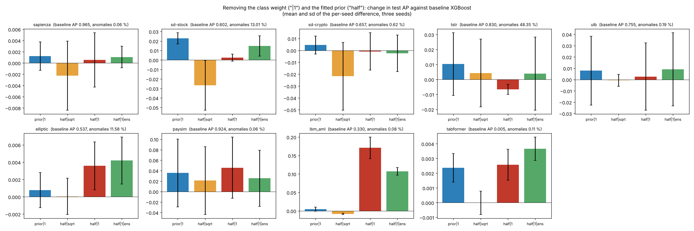
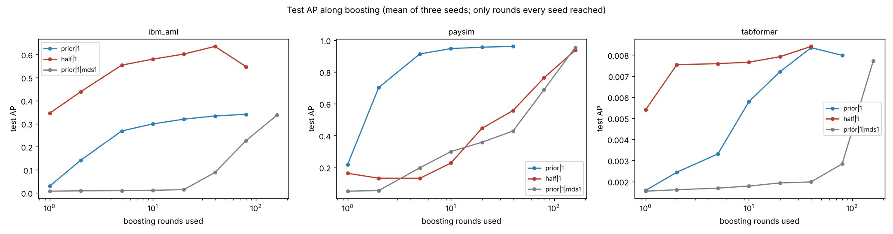

# 改动 XGBoost 的组成部件用于异常检测 · 中文 v5

版本:CN v5(2026-11-25)。英文版见 [KNOB_XGB_REPORT_EN_v5.md](KNOB_XGB_REPORT_EN_v5.md)。v1–v4 研究的是不改动 XGBoost 时的各种旋钮。本版改模型本身:每次删掉或加上一个部件,在同样的九项 Kronos_SupervisedAD 任务、同样的划分、阈值规则和三个种子上测量。

## 结论

1. **有效的改动是“删”而不是“加”:同时去掉正类权重和按先验拟合的起始分数。** 这样 XGBoost 让每一行都从概率 0.5 出发,两类权重都是 1。九项任务的测试 AP 平均提高 0.025;四项任务三个种子全部提升,最差的一项下降 0.007。
2. **IBM AML 上 AP 从 0.330 升到 0.501**(三个种子全部提升;已记录的 Kronos-mini 修复版是 0.266)。与保留先验起点的同一无权重模型相比,1% 误报率下的召回率从 0.38 升到 0.68。PaySim 从 0.924 升到 0.970,漏报从 1,543 降到 1,076。
3. **两项必须一起删。** 只去掉正类权重平均 +0.010 且从不变差;只去掉拟合的起始分数平均 −0.004;两者都去掉 +0.025。
4. **我设计的“加法”没有站住。** 我最先提出的组合——平衡装袋加一个不用标签的新颖度分支——是所有变体里最差的(平均 −0.008)。每个部件各自在一些任务上有用、在另一些任务上有害。
5. **焦点损失(focal loss)一度看起来是最好的单项改动,但对照实验表明功劳记错了。** 把它的聚焦指数设为 0 就是普通对数损失,而它在 IBM AML 上的提升一样大。提升来自起始分数,自定义损失的代码路径恰好改变了它。
6. **起始分数为什么在 IBM AML 上影响这么大,没有查明。** 检验了三种解释,没有一种能复现这个效应。

## 改了什么

基线:`binary:logistic`,`scale_pos_weight` = √(负 / 正),起始分数按类别先验拟合(XGBoost 2.0 起的默认行为),最多 600 轮并在验证集上早停,单个模型。

| 改动 | 类型 | 做法 |
| --- | --- | --- |
| 去掉正类权重 | 删 | `scale_pos_weight` = 1 |
| 去掉拟合的起始分数 | 删 | `base_score` = 0.5,每一行从分数 0 出发,而不是从异常比例的对数几率出发 |
| 种子集成 | 加 | 五个不同种子的模型,分数取平均 |
| 平衡装袋 | 删 + 加 | 五个模型,每个用全部异常加一份重新抽取的正常样本(max(10 × 异常数, 20,000)),权重为 1 |
| 焦点损失 | 换 | 用焦点损失(γ = 2)替换加权对数损失 |
| 新颖度分支 | 加 | 第二个 XGBoost,不看异常标签:区分真实的正常行与“在两条正常行之间交换特征组”造出的合成行;它的分数作为一个新特征加入 |

## 结果一:去掉正类权重和拟合的起始分数

测试 AP,三个种子均值。“提升的种子”指最后一列高于基线的种子数。

| 任务(训练集异常比例) | 基线 | 去掉正类权重 | 只去掉拟合起点 | 两者都去掉 | 提升的种子 |
| --- | ---: | ---: | ---: | ---: | ---: |
| IBM AML(0.08%) | 0.330 | 0.334 | 0.322 | **0.501** | 3/3 |
| PaySim(0.06%) | 0.924 | 0.960 | 0.945 | **0.970** | 2/3 |
| TabFormer(0.11%) | 0.0052 | 0.0075 | 0.0051 | **0.0077** | 3/3 |
| Elliptic(11.6%) | 0.537 | 0.537 | 0.537 | **0.540** | 3/3 |
| SD-FMM 股票(13%) | 0.602 | **0.625** | 0.575 | 0.604 | 3/3 |
| ULB(0.19%) | 0.755 | **0.763** | 0.754 | 0.758 | 1/3 |
| Sapienza(0.06%) | 0.965 | **0.966** | 0.963 | 0.966 | 2/3 |
| SD-FMM 加密货币(0.6%) | **0.657** | 0.662 | 0.635 | 0.656 | 1/3 |
| TSTR(48%) | 0.830 | **0.841** | 0.835 | 0.824 | 0/3 |
| 平均变化 | — | +0.010 | −0.004 | **+0.025** | |



- **IBM AML** 是效应最大的地方:三个种子分别是 0.532、0.486、0.484,基线是 0.33。验证阈值下的 F1 变化较小(0.421 → 0.442),因为提升出现在排序更靠后的位置。与保留先验起点的无权重模型相比,0.1% 误报率下的召回率从 0.33 升到 0.49,1% 下从 0.38 升到 0.68;分数最高的 1,567 行里的精确率从 0.34 升到 0.49。
- **PaySim** 变稳定:种子间标准差从 0.058 降到 0.002,误报从 54 降到 13,漏报从 1,543 降到 1,076。
- **TSTR** 的异常占 48%,它拟合出的起点本来就接近 0.5、权重接近 1;那里的 −0.007 是两个几乎相同的模型之间的种子噪声。
- **种子间波动**:九项任务的平均标准差从 0.017 降到 0.008(只去掉正类权重时是 0.004)。

### 差别出现在提升过程的哪一段



IBM AML 上,去掉权重和拟合起点的模型在 5 棵树后测试 AP 就到 0.55,40 棵树时到 0.64;保留拟合起点的模型无论多长都没有超过 0.35。验证集早停保留约 96 棵树,这时测试 AP 已回落到约 0.50,所以报告的 0.501 低于同一模型在 40 棵树时的水平。

PaySim 是另一回事。那里从 0.5 出发需要约 300 棵树才到 0.97,而保留拟合起点的模型只要允许训练下去也能到 0.96;基线在 PaySim 上的问题是停得太早(最少只有 11 棵树),v4 已经发现。

### 哪些解释不成立

| 假设 | 检验 | IBM AML 测试 AP |
| --- | --- | ---: |
| (参照)拟合起点、无权重 | | 0.334 |
| (参照)从 0.5 出发、无权重 | | 0.501 |
| 拟合起点使二阶导很小,`min_child_weight` = 1 挡住了小叶子 | 拟合起点 + `min_child_weight` = 0 | 0.334 |
| 拟合起点使异常叶子的牛顿步过大 | 拟合起点 + `max_delta_step` 1 / 0.3 | 0.369 / 0.346 |
| `reg_lambda` = 1 相对于很小的二阶导过大 | 拟合起点 + `reg_lambda` 0.001、步长上限 2 | 0.384 |
| (反向)在 0.5 起点下把 `reg_lambda` 调大 | 从 0.5 出发 + `reg_lambda` 100 | 0.378 |

前三项都没有让拟合起点的模型接近 0.50。最后一行说明这个效应确实依赖于正则相对二阶导较小,但在拟合起点下重新缩放正则不足以重现它。机制仍未查明。

## 结果二:各种“加法”

相对基线的测试 AP 变化,三个种子均值。

| 任务 | 种子集成 | 平衡装袋 | 焦点损失 | 新颖度特征 | 装袋 + 新颖度 |
| --- | ---: | ---: | ---: | ---: | ---: |
| Sapienza | −0.001 | −0.006 | −0.002 | +0.000 | −0.004 |
| SD-FMM 股票 | +0.002 | **+0.034** | −0.012 | −0.038 | −0.085 |
| SD-FMM 加密货币 | **+0.012** | +0.013 | −0.006 | +0.012 | +0.009 |
| TSTR | +0.009 | +0.008 | −0.006 | −0.034 | −0.008 |
| ULB | +0.019 | +0.009 | +0.000 | +0.020 | +0.011 |
| Elliptic | +0.001 | +0.001 | **+0.004** | +0.002 | +0.001 |
| PaySim | +0.034 | +0.027 | +0.010 | **+0.047** | +0.028 |
| IBM AML | **+0.003** | −0.009 | **+0.139** | −0.002 | −0.018 |
| TabFormer | −0.000 | −0.000 | **+0.003** | +0.000 | −0.001 |
| 平均 | +0.009 | +0.009 | +0.015 | +0.001 | −0.008 |
| AP 的平均种子间标准差(基线 0.017) | 0.002 | 0.003 | 0.015 | 0.007 | 0.006 |

加粗表示三个种子都成立的变化。

- **种子集成**:稳妥的加法。没有任何任务三个种子全降,种子间波动从 0.017 降到 0.002,代价是五倍训练量。
- **平衡装袋**:平均提升相近、成本不到一半,但在 IBM AML 上三个种子全降,在 Sapienza 上误报变成四倍(3.7 → 15)。
- **新颖度特征**:在异常会破坏正常样本联合结构的任务上有效——PaySim 达到 0.972 ± 0.002,漏报从 1,543 降到 1,080;在没有联合结构可学的任务上有害(SD-FMM 股票只有一个特征,TSTR 只有 577 个训练样本)。
- **装袋 + 新颖度**,即我最初的方案,是最差的变体,在三项任务上三个种子全降。

### 新颖度分支单独使用

不用任何异常标签,单独作为分数:

| 任务 | ROC AUC | AP | 有监督基线 AP |
| --- | ---: | ---: | ---: |
| PaySim | 0.944 | 0.412 | 0.924 |
| ULB | 0.836 | 0.473 | 0.755 |
| IBM AML | 0.699 | 0.229 | 0.330 |
| Elliptic | 0.596 | 0.076 | 0.537 |
| TabFormer | 0.585 | 0.0015 | 0.0052 |
| TSTR | 0.558 | 0.571 | 0.830 |
| SD-FMM 股票 | 0.439 | 0.130 | 0.602 |
| SD-FMM 加密货币 | 0.050 | 0.003 | 0.657 |
| Sapienza | 0.004 | 0.0003 | 0.965 |

在 PaySim、ULB、IBM AML 上,一个从没见过异常标签的模型也能把异常排在前面。在 Sapienza 和加密货币上 ROC AUC 接近 0:按这个度量,异常恰恰是最“不新颖”的行。有监督的树仍可把它当特征用,但单独作为分数没有用。

### 焦点损失:改变了归因的对照

焦点损失看起来是最大的单项提升(IBM AML +0.139)。XGBoost 的自定义损失从分数 0 出发,而不是从拟合的先验出发,所以我把聚焦指数 γ 一直扫到 0(此时焦点损失就是不加权的普通对数损失):

| γ | 0 | 0.5 | 1 | 2 | 3 |
| --- | ---: | ---: | ---: | ---: | ---: |
| IBM AML 测试 AP | 0.496 | 0.521 | 0.471 | 0.469 | 0.419 |

γ = 0 的提升与任何 γ > 0 一样大,聚焦在这里没有贡献;用内置损失、`base_score` = 0.5、不加权,得到同样的 0.50。在 SD-FMM 股票和加密货币上,这条曲线在种子噪声之内是平的。

## 与 Kronos_SupervisedAD 的比较(更新)

测试 AP。Kronos 为该仓库的记录,未重跑。

| 任务 | Kronos-mini 修复版 | XGBoost 基线 | 去掉正类权重和拟合起点 |
| --- | ---: | ---: | ---: |
| Sapienza 15S | 0.912 | 0.965 | **0.966** |
| SD-FMM 股票 | **0.630** | 0.602 | 0.604 |
| SD-FMM 加密货币 | 0.480 | **0.657** | 0.656 |
| TSTR | 0.486 | **0.830** | 0.824 |
| ULB | 0.754 | 0.755 | **0.758** |
| Elliptic | 0.435 | 0.537 | **0.540** |
| PaySim | 0.452 | 0.924 | **0.970** |
| IBM AML | 0.266 | 0.330 | **0.501** |
| TabFormer | 0.0074 | 0.0052 | **0.0077** |

## 局限

- **在它有效的任务上,验证集并不总会选中这项改动。** 它的验证 AP 在 IBM AML、ULB、TSTR 上高于基线,在 PaySim、TabFormer、Elliptic 上低于基线,尽管这三项的测试 AP 是提高的。采用它的依据是九项任务的整体对比,而不是逐任务按验证集选择。
- **IBM AML 上的机制没有弄清**;把五个这样的模型做集成反而降低了它的 AP(0.437,单模型是 0.501),这一点我同样解释不了。
- 结果依赖 XGBoost 3.4.1 和这套基线设置(学习率 0.05、深度 6、`reg_lambda` 1)。按先验拟合起始分数是 XGBoost 2.0 之后的默认行为,更早的版本本来就从 0.5 出发。
- 九项任务、三个种子,其中大幅度的效应只出现在一项任务上。TabFormer 对所有变体仍然不可用。
- γ 扫描只覆盖三项任务,其余因时间原因中止。
- 新颖度分支只用了简单的特征组交换来造合成行,没有尝试别的方式。

## 复现

数据准备同 v2。然后逐任务运行(参数同 v4):

```bash
python -m baselines.intercept_xgb   --dataset NAME [--variant V --flat FOLDER]   # 删除类改动
python -m baselines.intercept_probe --dataset NAME [--variant V --flat FOLDER]   # 沿提升轮数的曲线与假设检验
python -m baselines.dual_xgb        --dataset NAME [--variant V --flat FOLDER]   # 添加类改动
python -m baselines.focal_xgb       --dataset NAME [--variant V --flat FOLDER]   # γ 扫描
python -m baselines.intercept_aggregate && python -m baselines.dual_aggregate
```

结果在 `results/intercept_xgb/` 和 `results/dual_xgb/`。两核机器上一次只跑一个任务;两个任务并行会互相拖慢数倍。
