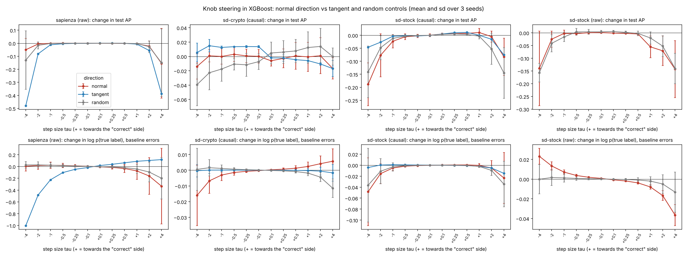

# Carrying the Knob method over to XGBoost for anomaly detection · English v1

Version: EN v1 (2026-11-24). Chinese version: [KNOB_XGB_REPORT_CN_v1.md](KNOB_XGB_REPORT_CN_v1.md).

## Conclusion

**The Knob method, carried over to XGBoost, did not give a reliable detection gain.** Across three tasks and three seeds, every change in test AP is inside the seed-to-seed spread, and steering along the "knob" normal direction is indistinguishable from steering along random or tangent directions.

- The only consistent sign is on Sapienza: misses fall from 9.7 to 8.7 (of 77 anomalies) and F1 rises from 0.910 to 0.919, with AP unchanged. That is one or two anomalies and cannot carry a conclusion.
- On SD-FMM crypto the validation-selected configuration raised test misses from 31.7 to 35.0.
- The reason is mechanistic: XGBoost's output is the plain sum of its stage contributions, so the hidden state holds no information beyond the output for a knob to exploit. See "How the knob affects detection".

Scope: Sapienza 15S, SD-FMM stock and SD-FMM crypto only. IBM TabFormer was not run (its preparation needs about 7 GB of memory plus the sequence model, which did not fit this environment).

## Method: paper → XGBoost

The paper (Huang, Mao, Jiang, Cambria, *Uncovering the Knowledge Boundaries and Mechanistic "Knob" of LLMs*) learns a correct/incorrect boundary on the last-prompt-token hidden states H ∈ ℝ^{L×d}, finds that a few dimensions (knobs) suffice, and shows that pushing those dimensions along the boundary normal raises the likelihood of the right answer while tangent and random pushes do not.

| Paper | Here |
| --- | --- |
| Hidden states H(x) ∈ ℝ^{L×d} | Staged contribution map: the boosted trees are cut into L=8 consecutive blocks; H[ℓ,j] is the TreeSHAP contribution of feature j from block ℓ. margin = bias + Σ H, checked numerically |
| Label "answer correct" | XGBoost's alert decision is right (TP/TN) or wrong (FN/FP), obtained out-of-fold on the training sequences |
| Multi-view CNN probe, LR / MLP baselines | Same (vertical, horizontal, local branches), kernels shrunk to L and d |
| Coarse-to-fine knobs: s_j = Σ_ℓ\|ΔA_ℓj\|, smallest k with Acc(J_k) ≥ Acc_full − 1% | Same, plus random feature subsets of equal size |
| Layer attention + KAN in knob space | Same (k-2-1 RBF-KAN); no symbolic distillation |
| Intervention: Δz̄ = τ/(‖∇Φ‖+ε)·d with the minimum-norm layer patch | Same; XGBoost reads every block additively, so the margin moves by the sum of the patch. Directions: normal, tangent, random |

Two further uses, not in the paper, added to give the method a fair chance:

- **Boundary gating**: move a score across the threshold in proportion to the knob boundary's probability that the current decision is wrong.
- **Boundary-guided retraining**: up-weight training rows the boundary places on the "incorrect" side and refit XGBoost.

Controls: a probe that sees only the margin and its distance to the threshold (uncertainty control), random knobs, and retraining weighted by margin uncertainty.

Protocol: probe, knobs and KAN use training sequences only; τ, λ and the choice of use are picked on validation AP with the baseline itself as a candidate; test labels are used once. The baseline matches the XGBoost runs recorded in [Knob](https://github.com/SansaZheng/Knob) seed by seed (identical AP, TP, FP).

## Results

Test split, mean ± sample sd over seeds 42, 13, 2026. "Knob-XGBoost" is the configuration chosen on validation for each seed.

| Task (features) | Method | AP | F1 | Misses FN | False alerts FP |
| --- | --- | ---: | ---: | ---: | ---: |
| Sapienza 15S (raw, 77 anomalies) | XGBoost | 0.9650 ± 0.0026 | 0.910 ± 0.008 | 9.7 | 3.7 |
| | Knob-XGBoost | 0.9649 ± 0.0029 | 0.919 ± 0.001 | 8.7 | 3.3 |
| SD-FMM crypto (causal, 68 anomalies) | XGBoost | 0.6571 ± 0.0139 | 0.609 ± 0.007 | 31.7 | 15.0 |
| | Knob-XGBoost | 0.6533 ± 0.0142 | 0.602 ± 0.010 | 35.0 | 8.7 |
| SD-FMM stock (raw, 99 anomalous points) | XGBoost | 0.6019 ± 0.0148 | 0.617 ± 0.011 | 39.7 | 34.0 |
| | Knob-XGBoost | 0.6058 ± 0.0073 | 0.615 ± 0.015 | 41.0 | 31.7 |
| SD-FMM stock (causal) | XGBoost | 0.4685 ± 0.0471 | 0.462 ± 0.020 | 53.3 | 53.3 |
| | Knob-XGBoost | 0.4656 ± 0.0515 | 0.457 ± 0.032 | 56.7 | 43.7 |

Per-seed test AP difference (Knob − baseline): Sapienza −0.0010 / 0 / +0.0008; crypto −0.0001 / +0.0045 / −0.0161; stock raw 0 / +0.0132 / −0.0015. No task shows a consistent direction.

**Subtle anomalies (those the baseline misses)**: on Sapienza the baseline misses 29 in total over the three seeds; the Knob configuration recovers 3 and loses none already caught. On crypto and stock it recovers none and loses 10 and 4–10 already-caught anomalies respectively. Recall with the alert count held at the baseline's: Sapienza 0.874 → 0.879, crypto 0.534 → 0.520, stock raw 0.599 → 0.603.

Each use on its own (best configuration on validation per use; change in test AP against the baseline, mean ± sd):

| Use | Sapienza | Crypto | Stock causal |
| --- | ---: | ---: | ---: |
| Normal-direction steering (the paper's method) | +0.0000 ± 0.0004 | −0.0039 ± 0.0108 | +0.0110 ± 0.0142 |
| Random-direction steering (control) | +0.0001 ± 0.0002 | +0.0042 ± 0.0156 | +0.0041 ± 0.0029 |
| Boundary gating | −0.0001 ± 0.0002 | −0.0084 ± 0.0367 | −0.0017 ± 0.0133 |
| Boundary-guided retraining | −0.0017 ± 0.0029 | −0.0326 ± 0.0294 | +0.0095 ± 0.0210 |
| Retraining by margin uncertainty (control) | −0.0033 ± 0.0006 | −0.0015 ± 0.0270 | +0.0010 ± 0.0260 |



## How the knob affects detection

**1. The boundary is learnable, but carries no more than the margin itself.** Grouped-CV balanced accuracy (chance 0.50):

| | Sapienza | Crypto | Stock causal |
| --- | ---: | ---: | ---: |
| Full H, CNN probe | 0.818 | 0.754 | 0.531 |
| Knobs (top-k features) | 0.855 | 0.749 | 0.573 |
| Random feature subsets of the same size (mean) | 0.790 | 0.748 | 0.534 |
| Margin and distance to threshold only (control) | **0.953** | **0.829** | **0.577** |

In an LLM the hidden state holds far more than the one output token, so a probe can see that the model "does not actually know". XGBoost's margin is the sum of H, and H holds almost nothing about right-versus-wrong beyond that margin. On the stock subset the boundary is barely learnable at all.

**2. The knobs are neither stable nor specific.** Two of three Sapienza seeds give a single knob, `std_volume`; the third gives no compact set (k=13, every feature). The crypto seeds give k=1 (`std16`), 3 and 7. A randomly chosen single feature reaches 0.91–0.93 at best, above the knob's 0.84–0.88. Judging the baseline's test-set errors, the knob KAN reaches balanced accuracy 0.735 and a random knob 0.807 (Sapienza, 12–14 errors per seed). In the paper none of the random 2-dimensional subsets matched the knobs; that does not hold here.

**3. Normal-direction steering lacks the paper's specific effect.** The paper's key evidence is that the normal direction works and tangent and random do not. Measured as the change in log-likelihood of the true label on the baseline's errors: on Sapienza at τ=−1 the normal direction gives +0.021 and the random direction +0.022, the same; on crypto the normal direction gives −0.003, opposite in sign and near zero. At |τ|=4 every direction simply breaks the ranking on Sapienza, with AP falling by 0.05–0.48.

**4. Pushing towards the "correct" side makes XGBoost hold its current decision more firmly.** The boundary knows only whether a row looks like one that gets misjudged, not its true label. In an LLM the later layers decide the output after the push; XGBoost has no later computation, so pushing contributions edits the score directly. The signs on Sapienza fit this reading: positive τ makes the errors worse (−0.075 log-likelihood at τ=+1), negative τ helps slightly, but so does a random direction. This is an interpretation of the results and was not tested separately.

**5. Retraining moves the precision–recall trade-off, not the ranking quality.** On Sapienza boundary-guided retraining removes 1.3 misses on average (fewer in all three seeds) and adds 0.7 false alerts, while AP drops by 0.002. On stock it removes 16 false alerts and adds 6 misses; on crypto the three seeds disagree. These are shifts around the threshold, not new discriminating power.

## Limitations

- Errors are few (about 30 out-of-fold errors on the Sapienza training set), so the probes and the knob ranking have high variance.
- Only 7–13 feature dimensions (1 for stock raw); the paper finds 2 of 4096, so "a few dimensions" means little here.
- The out-of-fold models are not the final model and their contribution maps differ; the effect of that difference was not measured separately.
- No symbolic distillation of the KAN; the CNN input is standardised per cell instead of the paper's LayerNorm.
- TabFormer was not run.

## Reproduce

```bash
pip install numpy pandas scikit-learn xgboost torch matplotlib
for d in sapienza sd-stock sd-crypto; do python -m baselines.knob_xgb --dataset $d; done
python -m baselines.knob_xgb --dataset sd-stock --variant raw
python -m baselines.knob_aggregate
```

2 CPU cores, 8 GB memory, about 40 minutes in total. Every run was repeated once with identical numbers, and 24 metric sets re-derived from the saved scores all agree (`results/knob/audit.csv`).
