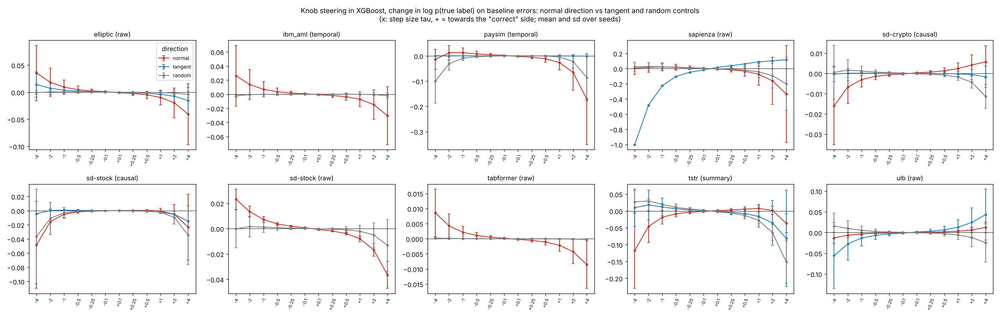
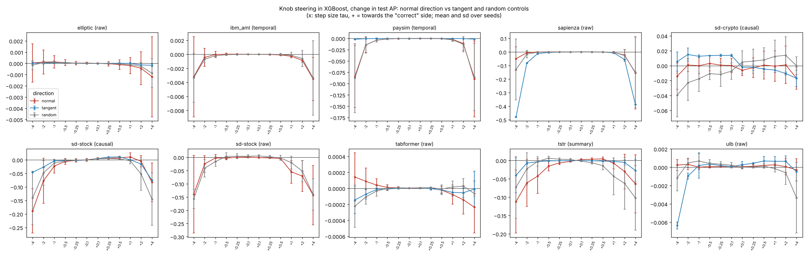

# Knob-XGBoost against Kronos_SupervisedAD · English v2

Version: EN v2 (2026-11-24). Chinese version: [KNOB_XGB_REPORT_CN_v2.md](KNOB_XGB_REPORT_CN_v2.md). The previous [EN v1](KNOB_XGB_REPORT_EN_v1.md) covered three market tasks; this version covers all nine public tasks of [Kronos_SupervisedAD](https://github.com/SansaZheng/Kronos_SupervisedAD) and compares against that repository's methods in one table.

## Conclusions

1. **XGBoost is clearly above the recorded Kronos-mini on six of nine tasks, level on one and below on two.** Above: Sapienza, SD-FMM crypto, TSTR, Elliptic, PaySim, IBM AML. Level: ULB. Below: SD-FMM stock (0.602 against 0.630, Kronos single seed) and TabFormer (both under 0.01 AP, neither usable).
2. **The knob still gives no reliable detection gain.** Knob-XGBoost changes test AP by −0.004 to +0.015 against XGBoost. Only Elliptic is positive on all three seeds (+0.003); TabFormer is negative on all three. Where there is a gain, the control that retrains with plain uncertainty weights gains as much.
3. **New: on wider transaction tables the knob exists and is specific, but does not turn into a detection gain.** On Elliptic, PaySim, IBM AML and TabFormer the knob features clearly beat random features, and steering along the normal changes the likelihood on misjudged rows while a random direction does not. Both match the paper and were absent on the market data of v1. The boundary still carries no more than the score, and the ranking barely moves.

All Kronos numbers are that repository's records and were not rerun (they need a GPU and the pretrained weights). IEEE-CIS is not distributed with the repository and was not run.

## Setup

- **Data and splits**: built by calling Kronos_SupervisedAD's own preparation code (same seed 42, 500k / 100k train / validation caps, complete test period), so the train, validation and test rows are those of its Kronos runs. Test row and positive counts match its records on all nine tasks.
- **Features**: two variants per task — the prepared features of the current observation (raw), and the design of that repository's boosting control (temporal: current value, one-step change, deviation from the mean of the last 4/16/64 observations). The variant with the higher mean validation AP over three XGBoost seeds is used. TSTR is whole-sequence classification and uses the whole-sequence summary.
- **Compared**: Kronos-mini R0 (first version), Kronos-mini repaired (the recipe that repository selected after its repair rounds), its HistGradientBoosting control (rerun here with its settings), XGBoost, Knob-XGBoost.
- **Knob-XGBoost** as in v1: staged contribution map as hidden state, a correct/incorrect boundary, knobs, then normal steering, boundary gating and boundary-guided retraining, with the configuration chosen on validation AP.
- Thresholds are chosen on validation F1. XGBoost rows are mean ± sample sd over seeds 42, 13, 2026.

To finish on two CPU cores, the subset probes on the three large tasks (PaySim, IBM AML, TabFormer) and on Elliptic use MLP+LR instead of the CNN, and the CNN is trained in mini-batches; the large tasks try two retraining weights and five random subsets. TabFormer uses raw features only and has no HistGradientBoosting control (not enough memory).

## Comparison with the Kronos_SupervisedAD methods

Test AP / F1.

| Task (test positives) | Kronos-mini R0 | Kronos-mini repaired | HistGB control | XGBoost | Knob-XGBoost |
| --- | ---: | ---: | ---: | ---: | ---: |
| Sapienza 15S (77) | 0.752 / 0.701 | 0.912 / 0.857 | 0.954 / 0.904 | **0.965 ± 0.003** / 0.910 | 0.965 ± 0.003 / 0.919 |
| SD-FMM stock (99) | 0.578 / 0.609 | **0.630** / 0.590 | 0.443 / 0.432 | 0.602 ± 0.015 / 0.617 | 0.606 ± 0.007 / 0.615 |
| SD-FMM crypto (68) | 0.357 / 0.403 | 0.480 / 0.431 | 0.648 / 0.581 | **0.657 ± 0.014** / 0.609 | 0.653 ± 0.014 / 0.602 |
| TSTR (94) | 0.488 / 0.654 | 0.486 / 0.654 | 0.826 / 0.785 | 0.830 ± 0.023 / 0.756 | **0.836 ± 0.011** / 0.767 |
| ULB credit card (52) | 0.317 / 0.366 | 0.754 ± 0.010 / 0.784 | **0.776** / 0.826 | 0.755 ± 0.031 / 0.764 | 0.770 ± 0.004 / 0.786 |
| Elliptic (408) | 0.277 / 0.323 | 0.435 / 0.501 | **0.542** / 0.569 | 0.537 ± 0.004 / 0.562 | 0.540 ± 0.002 / 0.567 |
| PaySim (4,010) | 0.041 / 0.003 | 0.452 ± 0.197 / 0.120 | **0.975 ± 0.001** / 0.885 | 0.924 ± 0.058 / 0.754 | 0.931 ± 0.062 / 0.787 |
| IBM AML (1,567) | 0.071 / 0.162 | 0.266 / 0.348 | 0.242 ± 0.012 / 0.345 | 0.330 ± 0.002 / 0.421 | **0.332 ± 0.003** / 0.422 |
| TabFormer (4,454) | 0.0014 / 0.002 | **0.0074 ± 0.0008** / 0.011 | not run | 0.0052 ± 0.0007 / 0.010 | 0.0044 ± 0.0011 / 0.007 |

The three Kronos-repaired cells with ± are that repository's three-seed confirmation records; the rest are single seed (42). The full table, with precision, recall and the feature variants not chosen, is `results/kronos_compare/comparison.csv`.

Reading notes:

- **On TSTR Kronos's AP equals the positive rate (0.48)**, so it learned nothing; trees reach 0.83 from six whole-sequence summary features.
- **XGBoost varies a lot across seeds on PaySim** (0.859–0.972). Validation holds 33 positives and early stopping lands anywhere between 13 and 132 trees. The HistGradientBoosting control runs a fixed 100 rounds without early stopping and is both the steadiest and the best.
- **Nothing is usable on TabFormer.** These features are single-transaction fields with no per-card history. The 0.078 reached earlier in the Knob repository used per-card aggregates and sequence embeddings; those are different features and do not belong in this table.
- **On ULB the three (Kronos repaired, XGBoost, HistGB) are level**; the test split has 52 positives.

## Effect of the knob on detection

Change in test AP (Knob-XGBoost − XGBoost), mean ± sd over three seeds, and what happens to misses:

| Task | ΔAP | ΔF1 | Baseline misses | Recovered / lost |
| --- | ---: | ---: | ---: | ---: |
| Elliptic | +0.0032 ± 0.0014 | +0.004 | 223 | 1.7 / 1.0 |
| IBM AML | +0.0019 ± 0.0041 | +0.001 | 1,130 | 9.0 / 8.3 |
| PaySim | +0.0064 ± 0.0109 | +0.033 | 1,543 | 234 / 46 |
| ULB | +0.0147 ± 0.0281 | +0.022 | 15.7 | 1.3 / 0.3 |
| TSTR | +0.0058 ± 0.0141 | +0.011 | 21.7 | 4.0 / 3.7 |
| Sapienza | −0.0001 ± 0.0009 | +0.009 | 9.7 | 1.0 / 0 |
| SD-FMM stock | +0.0039 ± 0.0081 | −0.003 | 39.7 | 0 / 1.3 |
| SD-FMM crypto | −0.0039 ± 0.0108 | −0.007 | 31.7 | 0 / 3.3 |
| TabFormer | −0.0008 ± 0.0005 | −0.003 | 4,430 | 0 / 7.0 |

"Recovered / lost" counts anomalies the baseline missed that the Knob configuration catches, and anomalies the baseline caught that it misses.

**The PaySim and ULB gains each come from one seed whose baseline stopped too early.** The PaySim seed-13 baseline trained 32 trees and retraining cut its misses from 1,670 to 1,093; the ULB seed-2026 baseline had 4 trees and retraining lifted AP from 0.720 to 0.767. The other two seeds barely move.

**These gains are not specific to the knob.** Change in test AP against the baseline, per use:

| Use | Elliptic | IBM AML | PaySim | ULB | TSTR | TabFormer |
| --- | ---: | ---: | ---: | ---: | ---: | ---: |
| Normal steering (the paper's method) | +0.0004 | −0.0001 | −0.0007 | +0.0007 | −0.0073 | +0.0001 |
| Random-direction steering (control) | +0.0000 | −0.0006 | −0.0015 | −0.0009 | +0.0000 | +0.0000 |
| Boundary gating | +0.0006 | −0.0007 | −0.0089 | −0.0371 | −0.0006 | +0.0001 |
| Boundary-guided retraining | +0.0012 | +0.0035 | +0.0424 | +0.0129 | +0.0012 | −0.0015 |
| Retraining by score uncertainty (control) | +0.0038 | +0.0047 | +0.0301 | +0.0094 | +0.0055 | −0.0011 |
| Retraining with a random knob (control) | +0.0024 | +0.0027 | +0.0030 | +0.0088 | +0.0029 | −0.0006 |

The paper's own method, normal steering, moves AP by no more than 0.001 everywhere except TSTR (−0.007). Only retraining helps, and ordinary retraining weighted by score uncertainty does as well or better.

## The knob itself: present on transaction tables

Grouped-CV balanced accuracy of the correct/incorrect boundary (chance 0.50):

| Task (features) | Best probe on the full map | Knobs | Random subsets, same size | Score only (control) |
| --- | ---: | ---: | ---: | ---: |
| Elliptic (94) | 0.691 | 0.702 | 0.637 | **0.907** |
| IBM AML (220) | 0.677 | 0.712 | 0.576 | **0.779** |
| PaySim (50) | 0.788 | 0.873 | 0.745 | **0.921** |
| TabFormer (42) | 0.763 | 0.765 | 0.690 | **0.812** |
| ULB (30) | 0.616 | 0.660 | 0.609 | **0.739** |
| TSTR (6) | 0.556 | 0.537 | 0.529 | **0.680** |

- **Knobs are few and fairly stable.** IBM AML needs one feature on all three seeds (`log_gap_seconds-mean4` twice); PaySim gives the same feature on two seeds (`category_type_TRANSFER-mean4`); TabFormer gives the same two or three merchant categories on all three (MCC 4829, 5300, 5311); Elliptic leads with `local_3` on two seeds. ULB and TSTR are unstable.
- **Knobs are specific.** On the four larger tasks the knobs beat random subsets, and on the test split the knob boundary judges the baseline's errors better than a random knob (Elliptic 0.670 against 0.579, IBM AML 0.631 against 0.530, PaySim 0.783 against 0.625, TabFormer 0.604 against 0.435).
- **Normal steering is direction-specific.** Change in log-likelihood of the true label on misjudged rows at τ=−1: Elliptic normal +0.0093, random +0.0004; IBM AML +0.0070, −0.0001; PaySim +0.0124, −0.0095; TabFormer +0.0021, 0.0000. This is the form of the paper's key evidence, and it holds on these four.
- **The sign is opposite to the paper's use, and the ranking does not change.** The helpful direction is negative τ, pushing rows away from the "correct" side; pushing towards it makes misjudged rows worse. The same step acts the other way on correctly judged rows, so overall AP moves by no more than 0.001.
- **The boundary still carries no more than the score.** On every task the control that sees only the score and its distance to the threshold beats the full contribution map.





## Limitations

- Kronos numbers are that repository's records, mostly single seed; hardware and training budget differ from the tree models here.
- Kronos reads raw features in 160-step windows; the trees read hand-built temporal features over the same windows. Same information, different form.
- Probe settings on the large and wide tasks are lighter than in v1 (see Setup), so their probe accuracies are not strictly comparable with the three market tasks.
- PaySim, ULB, SD-FMM and Sapienza have 33–67 validation positives, which affects both early stopping and configuration choice.
- TabFormer has no HistGradientBoosting control and no temporal features. IEEE-CIS was not run.
- The reading that pushing towards the "correct" side makes errors worse fits the signs on most tasks (not SD-FMM crypto, SD-FMM stock causal, TSTR or ULB, where the effect is near zero or reversed) and was not tested separately.

## Reproduce

```bash
pip install numpy "pandas<3" scikit-learn xgboost torch matplotlib huggingface_hub einops safetensors
git clone https://github.com/SansaZheng/Kronos_SupervisedAD && cd Kronos_SupervisedAD
export PYTHONPATH=/path/to/XGBoos:.
for d in tstr elliptic ulb paysim ibm_aml sd-stock sd-crypto sapienza; do
  python -m baselines.kronos_data --dataset $d --work /scratch/prep
  (cd /path/to/XGBoos && python -m baselines.kronos_compare --dataset $d --flat /scratch/prep/$d/flat --hgb)
done
python -m baselines.kronos_data --dataset tabformer --variants raw --work /scratch/prep
cd /path/to/XGBoos
python -m baselines.kronos_compare --dataset tabformer --flat /scratch/prep/tabformer/flat
export KNOB_TORCH_THREADS=2
python -m baselines.knob_xgb --dataset tstr --variant summary --flat /scratch/prep/tstr/flat
for d in ulb elliptic tabformer; do python -m baselines.knob_xgb --dataset $d --variant raw --flat /scratch/prep/$d/flat; done
for d in paysim ibm_aml; do python -m baselines.knob_xgb --dataset $d --variant temporal --flat /scratch/prep/$d/flat; done
python -m baselines.knob_aggregate && python -m baselines.kronos_table
```

pandas 2.x is required: pandas 3 changes timestamp resolution and breaks that repository's time splits for IBM AML and TabFormer. Commands for the three market tasks are in v1. Two CPU cores and 8 GB of memory; the six new tasks take about 3 hours. 60 metric sets re-derived from the saved scores all agree (`results/knob/audit.csv`).
