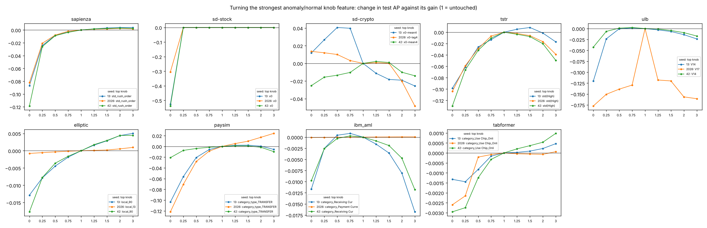
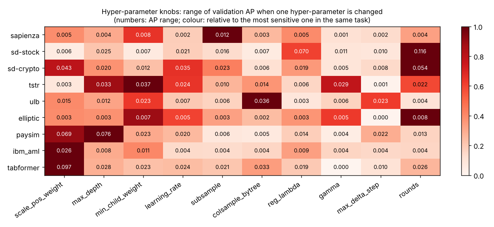

# Which XGBoost parameters control the anomaly / normal distinction, and what turning them does · English v3

Version: EN v3 (2026-11-25). Chinese version: [KNOB_XGB_REPORT_CN_v3.md](KNOB_XGB_REPORT_CN_v3.md). This version adds to [EN v2](KNOB_XGB_REPORT_EN_v2.md): the knobs in v2 were for the correct/incorrect boundary; here the boundary is anomaly / normal, and the knobs are actually turned. Data, splits and baselines are those of v2 (the nine Kronos_SupervisedAD tasks).

"XGBoost parameters" can be read two ways, and both were done:

- **Parameters inside the fitted model**: which feature contributions and which stretch of boosted trees carry the difference between the classes (Part 1).
- **Training hyper-parameters**: which of them decide how separable the classes are (Part 2).

## Conclusions

1. **Inside the model the knobs for anomaly / normal are clear, usually a single feature, but turning them does nothing.** On seven of nine tasks one feature reproduces the full anomaly / normal boundary, stably across seeds. Turning the gain of those knobs up or down changes test AP by −0.012 to +0.016, no differently from turning random features; the gain chosen on validation is mostly 1 (leave as is).
2. **Among hyper-parameters the knob that matters is `scale_pos_weight`.** It is the most sensitive hyper-parameter on four tasks. Tuning the two most sensitive hyper-parameters improves all three seeds on three tasks: PaySim (AP 0.924 → 0.967, misses 1,543 → 1,053), SD-FMM stock (0.602 → 0.651, false alerts 34 → 18) and TabFormer (0.0052 → 0.0078, still unusable).
3. **Hyper-parameter tuning does not help everywhere.** Sapienza falls on all three seeds (0.965 → 0.955), TSTR falls slightly, and the other four stay inside the seed spread.
4. **After tuning, SD-FMM stock is above the recorded Kronos-mini repaired run** (0.651 ± 0.003 against 0.630). Of the two tasks where XGBoost trailed Kronos in v2, only TabFormer remains, now level (0.0078 against 0.0074).

## Part 1: knobs inside the model

### Method

- **Hidden state** as in v1 and v2: the boosted trees are cut into 8 blocks, H[ℓ,j] is the TreeSHAP contribution of feature j from block ℓ, and score = bias + ΣH.
- **Boundary** is now anomaly / normal: hidden states are obtained out-of-fold on the training rows; all anomalies (at most 3,000) and 3,000 normals are used, and CNN, MLP and LR probes predict the label.
- **Knobs**: features are ranked by the paper's coarse-to-fine method, and the smallest k is taken whose probe is within 1 % of the full hidden state. Random feature subsets of the same size are the control.
- **Share**: how much of the gap "mean anomaly score − mean normal score" each feature and each block of trees carries.
- **Turning**: a gain g on a knob gives score' = score + (g−1) × that feature's (or block's) contribution. A gain on a block of trees multiplies the leaf weights of that block by g, a direct change to the model's parameters. Gains come from {0, 0.25, 0.5, 0.75, 1, 1.25, 1.5, 2, 3}, picked greedily one at a time on validation AP. The control turns random features the same way.

### Which parameters control the difference

Means over three seeds; "share" is the part of the score gap carried by the knob features.

| Task (features) | Boundary accuracy | Knobs | Knob features (seeds) | Knob / random accuracy | Gap share of knobs | Share of first half of trees |
| --- | ---: | ---: | --- | ---: | ---: | ---: |
| Sapienza (13) | 0.985 | 1 | `std_rush_order` (3/3) | 0.994 / 0.962 | 0.76 | 0.58 |
| SD-FMM stock (1) | 0.696 | 1 | the only feature | 0.688 / — | 1.00 | 0.46 |
| SD-FMM crypto (7) | 0.940 | 1 | `x0-mean4` (2/3) | 0.948 / 0.929 | 0.41 | 0.64 |
| TSTR (6) | 0.718 | 4 | `std`, `last`, `last-first` (3/3) | 0.715 / 0.695 | 0.78 | 0.68 |
| ULB (30) | 0.932 | 2 | `V14`, `V10`, `V17` (2/3 each) | 0.927 / 0.834 | 0.53 | 0.62 |
| Elliptic (94) | 0.975 | 35 | no compact set (16–64) | 0.969 / 0.962 | 0.66 | 0.80 |
| PaySim (50) | 0.983 | 1.3 | one-step change of `type=TRANSFER` (3/3) | 0.981 / 0.772 | 0.45 | 0.61 |
| IBM AML (220) | 0.796 | 1 | short-term deviation of `Receiving Currency=Bitcoin` (2/3) | 0.812 / 0.658 | 0.16 | 0.78 |
| TabFormer (42) | 0.852 | 1 | `Use Chip=Online Transaction` (3/3) | 0.857 / 0.681 | 0.44 | 0.68 |

- **The anomaly / normal boundary is easy to learn from the hidden state**, above 0.93 on six tasks; SD-FMM stock and TSTR sit near 0.70 and are the hardest tasks anyway.
- **Seven tasks need one feature.** On PaySim, IBM AML, TabFormer and ULB the knob is clearly stronger than random features (by 0.09–0.21); on Sapienza and crypto the margin is small because most features there carry class information.
- **The knob is usually the feature that carries most of the gap** (first or second in 26 of 27 runs). IBM AML is the exception: its knob carries 16 % of the gap and the largest share belongs to `Payment Format=ACH`.
- **The difference is built mainly by the early trees.** Outside SD-FMM stock the first half of the trees carries 58–80 % of the score gap.
- Elliptic has no compact knob: class information is spread over 16–64 features.

### What turning these knobs does

Change in test AP against the baseline, mean ± sd over three seeds.

| Task | Gains on knob features | Gains on random features (control) | Gains on blocks of trees | Change in misses, knob gains |
| --- | ---: | ---: | ---: | ---: |
| Sapienza | −0.0026 ± 0.0046 | −0.0017 | −0.0009 | +1.0 |
| SD-FMM stock | 0.0000 | — | +0.0015 | 0 |
| SD-FMM crypto | +0.0018 ± 0.0016 | +0.0022 | −0.0022 | +0.7 |
| TSTR | −0.0119 ± 0.0134 | −0.0033 | −0.0027 | −2.0 |
| ULB | −0.0018 ± 0.0017 | −0.0006 | −0.0079 | 0 |
| Elliptic | +0.0163 ± 0.0115 | +0.0146 | +0.0035 | −4.3 |
| PaySim | +0.0027 ± 0.0061 | −0.0001 | +0.0080 | +12.7 |
| IBM AML | −0.0005 ± 0.0009 | +0.0001 | +0.0006 | +1.3 |
| TabFormer | +0.0001 ± 0.0001 | 0.0000 | +0.0004 | −0.3 |

- **Turning the knobs does not improve detection.** No task shows a gain that is both outside the seed spread and above the random control.
- **The gain chosen on validation is mostly 1.** The first knob keeps gain 1 in 13 of 27 runs and, with two exceptions, stays between 0.75 and 1.5 in the rest. Training has already set these parts close to their best strength.
- **The +0.016 on Elliptic is not specific to the knobs**: turning random features gives +0.015. Validation and test periods differ a lot on this task (validation AP 0.93, test 0.54), and rescaling any batch of features moves the result similarly.
- **Gains on blocks of trees** (rescaling leaf weights) gain 0.003–0.023 on validation and mostly vanish on test; eight gains fitted on a few dozen validation positives overfit. The only larger effect is PaySim (+0.008, 52 fewer misses).



## Part 2: hyper-parameter knobs

### Method

Around the baseline setting, one hyper-parameter is changed at a time (two alternative values each), for 10 hyper-parameters. A hyper-parameter's sensitivity is the range of validation AP it produces. The two most sensitive are searched jointly (3×3), the setting is chosen on validation AP, then rerun on three seeds and compared with the baseline seed by seed. The scan uses seed 42.

Baseline: up to 600 rounds with early stopping after 50, learning rate 0.05, depth 6, row sampling 0.8, column sampling 0.8, `min_child_weight` 1, `scale_pos_weight` = √(negatives / positives).

### Which hyper-parameters control separability

Range of validation AP; the two most sensitive in each row are bold.

| Task | `scale_pos_weight` | `max_depth` | `min_child_weight` | learning rate | row sampling | column sampling | `reg_lambda` | `gamma` | `max_delta_step` | rounds |
| --- | ---: | ---: | ---: | ---: | ---: | ---: | ---: | ---: | ---: | ---: |
| Sapienza | 0.005 | 0.004 | **0.008** | 0.002 | **0.012** | 0.003 | 0.005 | 0.001 | 0.002 | 0.004 |
| SD-FMM stock | 0.006 | 0.025 | 0.007 | 0.021 | 0.016 | 0.007 | **0.070** | 0.011 | 0.010 | **0.116** |
| SD-FMM crypto | **0.043** | 0.020 | 0.012 | 0.035 | 0.023 | 0.006 | 0.019 | 0.005 | 0.008 | **0.054** |
| TSTR | 0.003 | **0.033** | **0.037** | 0.024 | 0.010 | 0.014 | 0.006 | 0.029 | 0.001 | 0.022 |
| ULB | 0.015 | 0.012 | **0.023** | 0.008 | 0.006 | **0.036** | 0.003 | 0.006 | 0.023 | 0.004 |
| Elliptic | 0.003 | 0.003 | **0.007** | 0.005 | 0.003 | 0.002 | 0.003 | 0.005 | 0.000 | **0.008** |
| PaySim | **0.069** | **0.076** | 0.023 | 0.020 | 0.006 | 0.005 | 0.014 | 0.004 | 0.022 | 0.013 |
| IBM AML | **0.026** | 0.008 | **0.011** | 0.004 | 0.004 | 0.004 | 0.009 | 0.004 | 0.004 | 0.004 |
| TabFormer | **0.097** | 0.028 | 0.023 | 0.024 | 0.021 | **0.033** | 0.020 | 0.000 | 0.011 | 0.026 |

- **`scale_pos_weight` (the weight on anomalies) is the most common knob**: in the top two on crypto, PaySim, IBM AML and TabFormer, with the largest ranges on those tasks. It sets directly how much score gap the model gives the anomaly class.
- **`min_child_weight` is in the top two on five tasks**, with small ranges.
- **The number of rounds is sensitive on the two SD-FMM tasks and Elliptic**, and on all three the baseline's early stopping is already the best choice.
- `gamma` and `max_delta_step` barely matter.



### Detection after tuning

Test split, mean ± sd over three seeds.

| Task | Tuned hyper-parameters and chosen values | AP baseline → tuned | Seeds improved | F1 | Misses FN | False alerts FP |
| --- | --- | ---: | ---: | ---: | ---: | ---: |
| PaySim | `scale_pos_weight` = negatives / positives (depth unchanged) | 0.924 ± 0.058 → **0.967 ± 0.006** | 3/3 | 0.754 → 0.842 | 1,543 → 1,053 | 54 → 48 |
| SD-FMM stock | `reg_lambda` = 10 (early stopping unchanged) | 0.602 ± 0.015 → **0.651 ± 0.003** | 3/3 | 0.617 → 0.663 | 39.7 → 41.0 | 34 → 18 |
| TabFormer | `scale_pos_weight` = 1, column sampling = 1 | 0.0052 → 0.0078 | 3/3 | 0.010 → 0.013 | 4,430 → 4,422 | 492 → 563 |
| IBM AML | `scale_pos_weight` = 1 | 0.330 ± 0.002 → 0.334 ± 0.004 | 2/3 | 0.421 → 0.425 | 1,130 → 1,119 | 69 → 92 |
| ULB | column sampling = 0.5, `min_child_weight` = 20 | 0.755 ± 0.031 → 0.765 ± 0.005 | 1/3 | 0.764 → 0.776 | 15.7 → 14.0 | 6.7 → 8.0 |
| SD-FMM crypto | `scale_pos_weight` = negatives / positives | 0.657 ± 0.014 → 0.659 ± 0.009 | 1/3 | 0.609 → 0.600 | 31.7 → 30.0 | 15.0 → 20.7 |
| Elliptic | baseline already best, unchanged | 0.537 → 0.537 | — | same | same | same |
| TSTR | depth = 3, `min_child_weight` = 5 | 0.830 ± 0.023 → 0.826 ± 0.002 | 1/3 | 0.756 → 0.758 | 21.7 → 21.3 | 25.3 → 25.3 |
| Sapienza | row sampling = 1 | 0.965 ± 0.003 → 0.955 ± 0.001 | 0/3 | 0.910 → 0.914 | 9.7 → 8.3 | 3.7 → 4.7 |

- **PaySim**: raising the anomaly weight from the square root of the class ratio to the full ratio improves all three seeds and cuts the seed spread from 0.058 to 0.006. The instability seen in v2 (early stopping anywhere between 13 and 132 trees) largely disappears. The tuned 0.967 is close to the 0.975 of Kronos_SupervisedAD's boosting control.
- **SD-FMM stock**: stronger L2 regularisation halves the false alerts and lifts AP above the recorded Kronos-mini repaired run (0.630). This task has one feature and six test sequences.
- **Sapienza is the counter-example**: validation AP rose by 0.0007 and test AP fell on all three seeds. Validation holds 50 positives, and so small a validation gain cannot be trusted.
- **The direction of the anomaly weight depends on the task**: up for PaySim and crypto, down for IBM AML and TabFormer. No single value works everywhere.

## Comparison with Kronos_SupervisedAD (updated)

Test AP. Kronos numbers are that repository's records, not rerun.

| Task | Kronos-mini repaired | XGBoost baseline | XGBoost, hyper-parameters tuned |
| --- | ---: | ---: | ---: |
| Sapienza 15S | 0.912 | **0.965** | 0.955 |
| SD-FMM stock | 0.630 | 0.602 | **0.651** |
| SD-FMM crypto | 0.480 | 0.657 | **0.659** |
| TSTR | 0.486 | **0.830** | 0.826 |
| ULB | 0.754 | 0.755 | **0.765** |
| Elliptic | 0.435 | **0.537** | 0.537 |
| PaySim | 0.452 | 0.924 | **0.967** |
| IBM AML | 0.266 | 0.330 | **0.334** |
| TabFormer | 0.0074 | 0.0052 | **0.0078** |

## Limitations

- The hyper-parameter scan uses seed 42 only, two alternative values per hyper-parameter, and a joint search over the two most sensitive. It answers which knobs matter; it is not a full tuning study.
- All choices are made on validation, where several tasks hold 33–100 positives; Sapienza shows that a small validation gain can reverse on test.
- Gains act on TreeSHAP contributions. A gain on a block of trees equals rescaling leaf weights; a gain on one feature reweights the read-out and does not correspond to a set of leaves that can be scaled independently.
- On the three large tasks and Elliptic the CNN probe is trained in mini-batches; subset probes use MLP+LR throughout.
- Kronos numbers are records, mostly single seed. Nothing is usable on TabFormer.

## Reproduce

Data preparation as in v2. Then:

```bash
export KNOB_TORCH_THREADS=2
for d in sapienza sd-crypto; do python -m baselines.knob_params --dataset $d; done
python -m baselines.knob_params --dataset sd-stock --variant raw
python -m baselines.knob_params --dataset tstr --variant summary --flat /scratch/prep/tstr/flat
for d in ulb elliptic tabformer; do python -m baselines.knob_params --dataset $d --variant raw --flat /scratch/prep/$d/flat; done
for d in paysim ibm_aml; do python -m baselines.knob_params --dataset $d --variant temporal --flat /scratch/prep/$d/flat; done
python -m baselines.knob_params_aggregate
```

Two CPU cores and 8 GB of memory, about 4 hours in all. Per-run records are in `results/knob_params/`.
