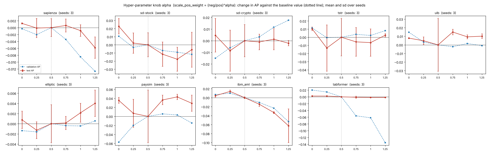
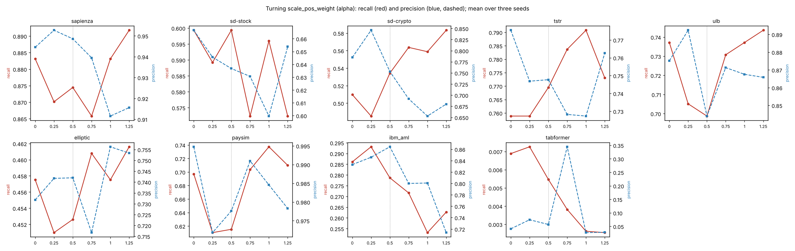
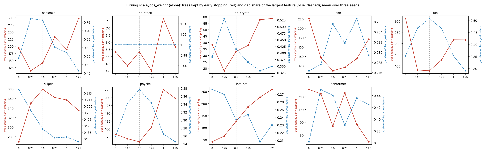
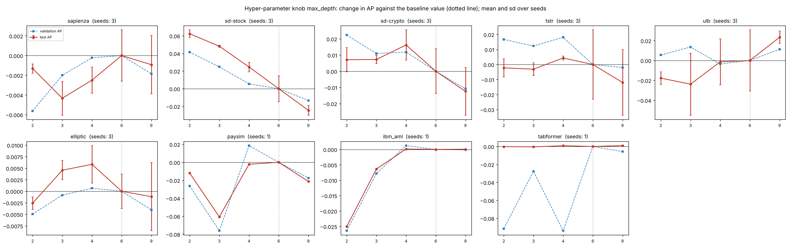
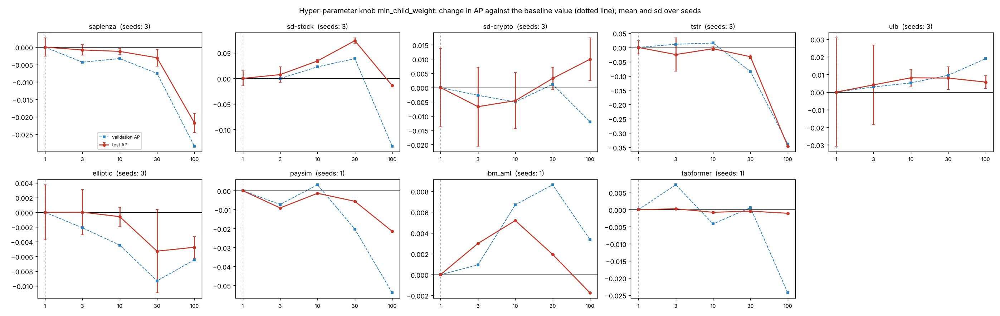
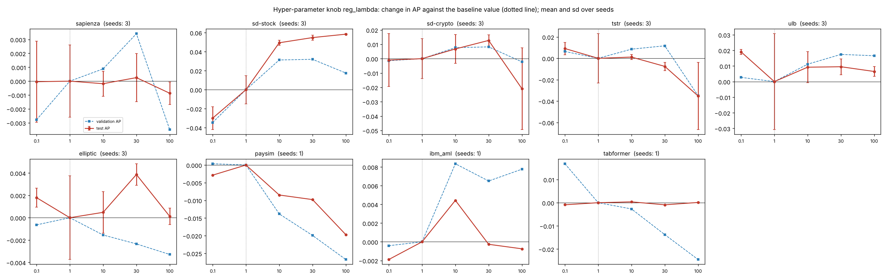

# The hyper-parameter knobs in focus · English v4

Version: EN v4 (2026-11-25). Chinese version: [KNOB_XGB_REPORT_CN_v4.md](KNOB_XGB_REPORT_CN_v4.md). [EN v3](KNOB_XGB_REPORT_EN_v3.md) found that training hyper-parameters are what actually changes detection, but scanned them coarsely (one seed, two alternative values each). This version runs a fine dose-response on four hyper-parameter knobs — 5–6 values each, three seeds — and records what happens inside the model at every value. Data, splits and baseline are those of v2 and v3.

## Conclusions

1. **What the four knobs do depends on the kind of task; there is no universal best value.** The nine tasks fall into four groups: small data that overfits (SD-FMM stock), train and test periods that differ (IBM AML, TabFormer), unstable early stopping (PaySim, ULB, TSTR) and saturated (Sapienza, Elliptic).
2. **`scale_pos_weight` (the weight on anomalies) reaches the most tasks, but its direction differs by group.** On IBM AML smaller is better and monotonically so (AP falls from 0.344 to 0.267); on PaySim the baseline value sits at the worst point and moving either way helps; on Sapienza and Elliptic it barely matters.
3. **The baseline anomaly weight (√ of the class ratio) is the least stable value across seeds on three tasks.** On PaySim, ULB and TSTR the seed sd at this value is 0.023–0.058; with the weight set to 1 it falls to 0.0005–0.006.
4. **The anomaly weight changes who carries the gap inside the model.** Near the baseline the anomaly-minus-normal score gap is most concentrated in one feature; with a larger weight it spreads over more features and more trees. On IBM AML that spreading goes together with falling test AP.
5. **Choosing one value of one knob on validation never lowered mean test AP on any of the nine tasks**, and improved all three seeds on four: SD-FMM stock +0.062, IBM AML +0.014, SD-FMM crypto +0.007, TabFormer +0.002.

## Method

One knob is moved at a time, everything else stays at the baseline (up to 600 rounds, early stopping after 50, learning rate 0.05, row and column sampling 0.8):

| Knob | Values (baseline bold) |
| --- | --- |
| Anomaly-weight exponent α, `scale_pos_weight` = (negatives / positives)^α | 0, 0.25, **0.5**, 0.75, 1, 1.25 |
| `max_depth` | 2, 3, 4, **6**, 9 |
| `min_child_weight` | **1**, 3, 10, 30, 100 |
| `reg_lambda` | 0.1, **1**, 10, 30, 100 |

α=0 is weight 1 (no reweighting); α=1 is the full class ratio. The six small tasks run every value on three seeds; the three large ones (PaySim, IBM AML, TabFormer) run α on three seeds and the other three knobs on seed 42.

Recorded per fit: validation / test AP, F1, precision, recall, misses and false alerts (threshold from validation F1); trees kept by early stopping; and, from TreeSHAP on validation rows, how the mean anomaly-minus-normal score gap is distributed — the share of the largest feature, the effective number of features carrying it, and the share of the first half of the trees.

## How far each knob can move test AP

Range of test AP across all values of a knob. The last column is the sd over three seeds at the baseline; a range has to exceed it clearly to count. * marks single-seed entries.

| Task | Anomaly weight α | `max_depth` | `min_child_weight` | `reg_lambda` | Seed sd at baseline |
| --- | ---: | ---: | ---: | ---: | ---: |
| SD-FMM stock | 0.041 | **0.087** | **0.088** | **0.088** | 0.015 |
| IBM AML | **0.077** | 0.025* | 0.007* | 0.006* | 0.002 |
| PaySim | 0.043 | 0.061* | 0.021* | 0.020* | 0.058 |
| TSTR | 0.024 | 0.016 | **0.346** | 0.044 | 0.023 |
| ULB | 0.015 | 0.047 | 0.008 | 0.019 | 0.031 |
| SD-FMM crypto | 0.013 | 0.029 | 0.017 | 0.034 | 0.014 |
| Sapienza | 0.007 | 0.004 | 0.022 | 0.001 | 0.003 |
| Elliptic | 0.005 | 0.008 | 0.005 | 0.004 | 0.004 |
| TabFormer | 0.004 | 0.001* | 0.001* | 0.001* | 0.001 |

The 0.346 on TSTR and the 0.022 on Sapienza both come from `min_child_weight` = 100 breaking the model (TSTR keeps one tree, Sapienza drops to 0.943 AP); they are not room for tuning.

## Focus 1: the anomaly weight

Mean test AP over three seeds:

| Task | α=0 | 0.25 | **0.5 (baseline)** | 0.75 | 1 | 1.25 |
| --- | ---: | ---: | ---: | ---: | ---: | ---: |
| IBM AML | 0.334 | **0.344** | 0.330 | 0.315 | 0.297 | 0.267 |
| TabFormer | **0.0075** | 0.0075 | 0.0052 | 0.0041 | 0.0034 | 0.0036 |
| SD-FMM stock | **0.625** | 0.604 | 0.602 | 0.590 | 0.584 | 0.596 |
| PaySim | 0.960 | 0.931 | 0.924 | 0.961 | **0.967** | 0.953 |
| ULB | 0.763 | 0.760 | 0.755 | **0.770** | 0.764 | 0.765 |
| TSTR | **0.841** | 0.817 | 0.830 | 0.825 | 0.824 | 0.833 |
| SD-FMM crypto | **0.662** | 0.649 | 0.657 | 0.656 | 0.659 | 0.655 |
| Sapienza | **0.966** | 0.965 | 0.965 | 0.966 | 0.964 | 0.959 |
| Elliptic | 0.537 | 0.535 | 0.537 | 0.537 | 0.539 | **0.541** |



**Tasks whose periods differ: the smaller the weight the better.** On IBM AML test AP falls monotonically with α, validation AP ranks the values exactly as test does (rank correlation 1.0), and all three seeds agree. TabFormer is also best at α ≤ 0.25. Both are time-split tasks with a large gap between validation and test.

**Tasks with unstable early stopping: the baseline value is the worst one.** The PaySim curve is U-shaped with α=0.5 at the bottom. The cause is early stopping: 59 trees are kept on average at α=0.5 and 226 at α=1. Seed sd at each value:

| Task | α=0 | 0.25 | **0.5 (baseline)** | 0.75 | 1 | 1.25 |
| --- | ---: | ---: | ---: | ---: | ---: | ---: |
| PaySim | 0.006 | 0.031 | **0.058** | 0.011 | 0.006 | 0.018 |
| ULB | 0.0005 | 0.005 | **0.031** | 0.003 | 0.002 | 0.003 |
| TSTR | 0.002 | 0.029 | 0.023 | 0.018 | 0.017 | 0.002 |

On these three the baseline value (or its neighbour 0.25) is the least stable position. Most of the PaySim and ULB "gains" seen in v2 and v3 are a move away from that unstable point.

**The exchange between misses and false alerts has no fixed direction.** As the weight grows:

- SD-FMM crypto behaves as expected: recall 0.51 → 0.58, precision 0.78 → 0.68 (misses 33 → 28, false alerts 10 → 19).
- Sapienza only gains false alerts (4 → 6.7) with misses about the same.
- IBM AML goes the other way: recall and precision fall together (0.286 → 0.263, 0.83 → 0.71).

So "raise the anomaly weight to cut misses" holds on some tasks only.



### How the anomaly weight changes the inside of the model

| Internal quantity | Observation |
| --- | --- |
| Trees kept by early stopping | Rises monotonically with α on IBM AML (42 → 258); crypto 38 → 59; PaySim has the fewest at α=0.5 (59) and the most at α=1 (226) |
| Gap share of the largest feature | Highest at α=0.25–0.5 and lower on both sides: Sapienza 0.54 → 0.77 → 0.46; ULB 0.35 → 0.51 → 0.29; PaySim 0.26 → 0.38 → 0.25; crypto 0.38 → 0.53 → 0.35 |
| Effective number of features carrying the gap | IBM AML 6.7 → 14.2 and Elliptic 12.4 → 16.6, rising monotonically with α |
| Gap share of the first half of the trees | Highest at α=0 (0.76–0.86) on seven of nine tasks |

This hyper-parameter knob therefore turns the internal knob found in v3. Near the baseline the difference between the classes rests most heavily on one feature (the single-feature knob of v3); at weight 1 it is built mainly by the earliest trees; at a large weight it is spread over more features and more trees. On IBM AML that spreading coincides with the monotone fall in test AP. This is an observed co-movement, not a causal experiment.



## Focus 2: the three regularisation knobs

**SD-FMM stock: regularising in any direction works.** The task has one feature and 2,560 training points, and the baseline keeps 5 trees on average under early stopping.

| Setting | Test AP | False alerts | Trees kept |
| --- | ---: | ---: | ---: |
| Baseline | 0.602 ± 0.015 | 34 | 5 |
| `max_depth` = 2 | 0.664 ± 0.004 | 20 | 27 |
| `min_child_weight` = 30 | **0.676** | 20 | 22 |
| `reg_lambda` = 100 | 0.660 | 20 | 78 |
| α = 0 | 0.625 | 30 | 5 |

The three regularisers do nearly the same thing: the model uses more, weaker trees, false alerts fall from 34 to about 20, and misses stay about the same.

**Elsewhere the effects are small and specific:**

- **SD-FMM crypto**: `reg_lambda` = 30 gives 0.670 (+0.013, all three seeds up); `max_depth` = 4 gives 0.673.
- **ULB**: for `max_depth`, validation and test point opposite ways. Validation picks depth 3 and test AP falls to 0.731 (down on all three seeds); the best on test is depth 9 (0.778). This is the worst validation miss among the nine tasks.
- **Elliptic**: `max_depth` = 4 cuts false alerts from 64 to 36, AP +0.006.
- **Sapienza, IBM AML, TabFormer, PaySim**: the three regularisers stay inside the seed spread (single seed for the last three).







## Does validation pick correctly

For each task, one value of one knob is chosen by mean validation AP over three seeds across all settings (α only on the large tasks):

| Task | Chosen setting | Test AP baseline → chosen | Per-seed difference | Seeds improved | F1 | Misses | False alerts |
| --- | --- | ---: | ---: | ---: | ---: | ---: | ---: |
| SD-FMM stock | `max_depth` = 2 | 0.602 → 0.664 | +0.062 ± 0.019 | 3/3 | 0.617 → 0.685 | 39.7 → 37.0 | 34 → 20 |
| IBM AML | α = 0.25 | 0.330 → 0.344 | +0.014 ± 0.005 | 3/3 | 0.421 → 0.435 | 1,130 → 1,108 | 69 → 86 |
| SD-FMM crypto | `max_depth` = 2 | 0.657 → 0.664 | +0.007 ± 0.008 | 3/3 | 0.609 → 0.630 | 31.7 → 28.0 | 15 → 19 |
| TabFormer | α = 0 | 0.0052 → 0.0075 | +0.0024 ± 0.0010 | 3/3 | 0.010 → 0.012 | 4,430 → 4,423 | 492 → 818 |
| PaySim | α = 0.75 | 0.924 → 0.961 | +0.036 ± 0.060 | 2/3 | 0.754 → 0.823 | 1,543 → 1,189 | 54 → 26 |
| Elliptic | `max_depth` = 4 | 0.537 → 0.543 | +0.006 ± 0.007 | 2/3 | 0.562 → 0.590 | 223 → 222 | 64 → 36 |
| Sapienza | `reg_lambda` = 30 | 0.9650 → 0.9652 | +0.0003 ± 0.0010 | 2/3 | 0.910 → 0.916 | 9.7 → 10.0 | 3.7 → 2.3 |
| ULB | `min_child_weight` = 100 | 0.755 → 0.761 | +0.006 ± 0.028 | 1/3 | 0.764 → 0.795 | 15.7 → 14.0 | 6.7 → 5.7 |
| TSTR | `max_depth` = 4 | 0.830 → 0.835 | +0.004 ± 0.023 | 1/3 | 0.756 → 0.788 | 21.7 → 21.0 | 25.3 → 18.3 |

- No mean change is negative; the reliable ones (all three seeds up) are the first four.
- F1 rises on all nine, mostly through fewer false alerts.
- Validation AP and test AP usually rank the values the same way, with exceptions: α on crypto (rank correlation −0.26) and ULB (−0.60) run opposite; on TabFormer validation AP drops from 0.296 to 0.140 with α while test AP only moves between 0.003 and 0.008.
- Against v3: choosing on the three-seed mean is steadier than v3's single-seed choice. The setting v3 chose on Sapienza cost 0.010 test AP; that does not recur here.

## What to turn by kind of task

| Kind | Tasks | Knob that matters | Direction |
| --- | --- | --- | --- |
| Small data, baseline overfits | SD-FMM stock | any of depth, `min_child_weight`, `reg_lambda` | regularise more |
| Train and test periods differ | IBM AML, TabFormer | anomaly weight | lower (α ≤ 0.25) |
| Unstable early stopping | PaySim, ULB, TSTR | anomaly weight | away from α=0.5; α=0 or 1 is steadiest |
| Sequence task, few features | SD-FMM crypto | depth, `reg_lambda` | shallower, stronger regularisation; small effect |
| Saturated | Sapienza, Elliptic | none | keep the baseline |

This is an after-the-fact grouping of nine tasks with one to three tasks per kind; it is not a validated rule.

## Limitations

- One knob at a time, no joint search; on SD-FMM stock the three regularisers act alike and whether they add up was not tested.
- On the three large tasks depth, `min_child_weight` and `reg_lambda` have one seed; PaySim's seed sd at the baseline is 0.058, so those single-seed curves support no conclusion.
- Early stopping and the choice of value use the same validation split, which holds 33–100 positives on several tasks.
- The link between internal quantities and test AP is co-movement, not causation.
- Four hyper-parameters only; learning rate, row and column sampling and the number of rounds also showed some sensitivity in v3's coarse scan and are not treated here.

## Reproduce

Data preparation as in v2. Then:

```bash
for d in sapienza sd-crypto; do python -m baselines.knob_hyper_focus --dataset $d; done
python -m baselines.knob_hyper_focus --dataset sd-stock --variant raw
python -m baselines.knob_hyper_focus --dataset tstr --variant summary --flat /scratch/prep/tstr/flat
for d in ulb elliptic tabformer; do python -m baselines.knob_hyper_focus --dataset $d --variant raw --flat /scratch/prep/$d/flat; done
for d in paysim ibm_aml; do python -m baselines.knob_hyper_focus --dataset $d --variant temporal --flat /scratch/prep/$d/flat; done
python -m baselines.knob_hyper_aggregate
```

Two CPU cores and 8 GB of memory, about 2.5 hours. Per-run records, curve tables and figures are in `results/knob_hyper/`.
