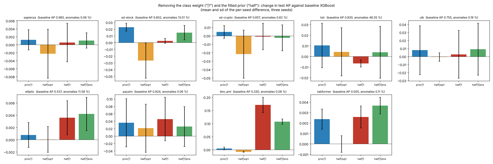
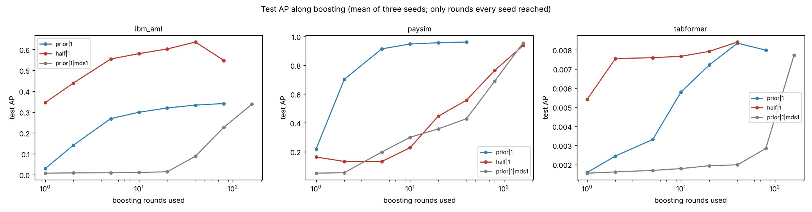

# Changing XGBoost's components for anomaly detection · English v5

Version: EN v5 (2026-11-25). Chinese version: [KNOB_XGB_REPORT_CN_v5.md](KNOB_XGB_REPORT_CN_v5.md). Versions v1–v4 studied knobs on an unchanged XGBoost. This version changes the model itself: components are removed or added one at a time and each change is measured on the same nine Kronos_SupervisedAD tasks, splits, threshold rule and three seeds as before.

## Conclusions

1. **The change that works is a deletion, not an addition: remove the class weight and the fitted starting score together.** XGBoost then starts every row at probability 0.5 with weight 1 on both classes. Mean test AP rises by 0.025 over the nine tasks; four tasks improve on all three seeds and the worst task loses 0.007.
2. **On IBM AML this lifts AP from 0.330 to 0.501** (all three seeds; Kronos-mini repaired is recorded at 0.266). Against the same unweighted model with the fitted start, recall at a 1 % false-positive rate goes from 0.38 to 0.68. PaySim goes from 0.924 to 0.970 with misses down from 1,543 to 1,076.
3. **Both deletions are needed.** Removing only the class weight gains 0.010 on average and never hurts; removing only the fitted starting score loses 0.004; removing both gains 0.025.
4. **The additions I designed did not hold up.** The combination I proposed first — balanced bagging plus a label-free novelty branch — is the worst variant (−0.008 on average). Each part helps on some tasks and hurts on others.
5. **Focal loss looked like the best single change, and a control showed the credit was misplaced.** With its focusing exponent set to 0 it is plain log-loss, and it gains just as much on IBM AML. The gain came from the starting score, which the custom-loss code path happens to change.
6. **Why the starting score matters so much on IBM AML is not established.** Three explanations were tested and none reproduces the effect.

## What was changed

Baseline: `binary:logistic`, `scale_pos_weight` = √(negatives / positives), starting score fitted to the class prior (the XGBoost default since 2.0), up to 600 rounds with early stopping on validation, one booster.

| Change | Kind | What it does |
| --- | --- | --- |
| No class weight | removal | `scale_pos_weight` = 1 |
| No fitted starting score | removal | `base_score` = 0.5, so every row starts at margin 0 instead of at the log-odds of the anomaly rate |
| Seed ensemble | addition | five boosters with different seeds, margins averaged |
| Balanced bagging | removal + addition | five boosters, each on all anomalies plus a fresh sample of normals (max(10 × anomalies, 20,000)), weight 1 |
| Focal loss | swap | focal loss (γ = 2) in place of weighted log-loss |
| Novelty branch | addition | a second XGBoost that sees no anomaly label: it separates real normal rows from synthetic rows made by swapping feature groups between two normal rows; its margin is appended as one input feature |

## Result 1: removing the class weight and the fitted starting score

Test AP, mean over three seeds. "Seeds up" counts seeds where the last column beats the baseline.

| Task (training anomaly rate) | Baseline | No class weight | No fitted start only | Both removed | Seeds up |
| --- | ---: | ---: | ---: | ---: | ---: |
| IBM AML (0.08 %) | 0.330 | 0.334 | 0.322 | **0.501** | 3/3 |
| PaySim (0.06 %) | 0.924 | 0.960 | 0.945 | **0.970** | 2/3 |
| TabFormer (0.11 %) | 0.0052 | 0.0075 | 0.0051 | **0.0077** | 3/3 |
| Elliptic (11.6 %) | 0.537 | 0.537 | 0.537 | **0.540** | 3/3 |
| SD-FMM stock (13 %) | 0.602 | **0.625** | 0.575 | 0.604 | 3/3 |
| ULB (0.19 %) | 0.755 | **0.763** | 0.754 | 0.758 | 1/3 |
| Sapienza (0.06 %) | 0.965 | **0.966** | 0.963 | 0.966 | 2/3 |
| SD-FMM crypto (0.6 %) | **0.657** | 0.662 | 0.635 | 0.656 | 1/3 |
| TSTR (48 %) | 0.830 | **0.841** | 0.835 | 0.824 | 0/3 |
| Mean change | — | +0.010 | −0.004 | **+0.025** | |



- **IBM AML** is where the effect is large: 0.532, 0.486 and 0.484 on the three seeds against 0.33 for the baseline. F1 at the validation threshold moves less (0.421 → 0.442) because the gain is further down the ranking. Compared with the unweighted model that keeps the fitted start, recall at 0.1 % false-positive rate rises from 0.33 to 0.49 and at 1 % from 0.38 to 0.68; precision among the top 1,567 scores rises from 0.34 to 0.49.
- **PaySim** becomes stable: seed sd falls from 0.058 to 0.002, false alerts from 54 to 13, misses from 1,543 to 1,076.
- **TSTR** has 48 % anomalies, so its fitted start is already near 0.5 and its class weight near 1; the −0.007 there is seed noise between two almost identical models.
- **Seed spread** over the nine tasks falls from a mean sd of 0.017 to 0.008 (0.004 with only the class weight removed).

### Where along boosting the difference appears



On IBM AML the model without class weight and fitted start reaches test AP 0.55 after 5 trees and 0.64 after 40; the model with the fitted start never passes 0.35 at any length. Early stopping on validation keeps about 96 trees, by which point test AP has fallen back to about 0.50, so the reported 0.501 is below what the same model had at 40 trees.

PaySim is a different story. There the start at 0.5 needs about 300 trees to reach 0.97, and the fitted-start model reaches 0.96 as well when it is allowed to run; the baseline's problem on PaySim is stopping too early (as few as 11 trees), which v4 already found.

### What does not explain the IBM AML effect

| Hypothesis | Test | Test AP on IBM AML |
| --- | --- | ---: |
| (reference) fitted start, no class weight | | 0.334 |
| (reference) start at 0.5, no class weight | | 0.501 |
| The fitted start makes hessians tiny, so `min_child_weight` = 1 blocks small leaves | fitted start with `min_child_weight` = 0 | 0.334 |
| The fitted start makes Newton steps on anomaly leaves too large | fitted start with `max_delta_step` 1 / 0.3 | 0.369 / 0.346 |
| `reg_lambda` = 1 is large relative to tiny hessians | fitted start with `reg_lambda` 0.001 and step cap 2 | 0.384 |
| (converse) make `reg_lambda` large at the 0.5 start | start at 0.5 with `reg_lambda` 100 | 0.378 |

None of the first three brings the fitted-start model near 0.50. The last row shows the effect does depend on regularisation being small relative to the hessians, but rescaling regularisation under the fitted start is not enough to recreate it. The mechanism is open.

## Result 2: the additions

Change in test AP against the baseline, mean over three seeds.

| Task | Seed ensemble | Balanced bagging | Focal loss | Novelty feature | Bagging + novelty |
| --- | ---: | ---: | ---: | ---: | ---: |
| Sapienza | −0.001 | −0.006 | −0.002 | +0.000 | −0.004 |
| SD-FMM stock | +0.002 | **+0.034** | −0.012 | −0.038 | −0.085 |
| SD-FMM crypto | **+0.012** | +0.013 | −0.006 | +0.012 | +0.009 |
| TSTR | +0.009 | +0.008 | −0.006 | −0.034 | −0.008 |
| ULB | +0.019 | +0.009 | +0.000 | +0.020 | +0.011 |
| Elliptic | +0.001 | +0.001 | **+0.004** | +0.002 | +0.001 |
| PaySim | +0.034 | +0.027 | +0.010 | **+0.047** | +0.028 |
| IBM AML | **+0.003** | −0.009 | **+0.139** | −0.002 | −0.018 |
| TabFormer | −0.000 | −0.000 | **+0.003** | +0.000 | −0.001 |
| Mean | +0.009 | +0.009 | +0.015 | +0.001 | −0.008 |
| Mean seed sd of AP (baseline 0.017) | 0.002 | 0.003 | 0.015 | 0.007 | 0.006 |

Bold marks changes that hold on all three seeds.

- **Seed ensemble**: the safe addition. It never falls on all three seeds, cuts the seed spread from 0.017 to 0.002, and costs five times the training.
- **Balanced bagging**: about the same average gain at under half the cost, but it loses on IBM AML on all three seeds and quadruples false alerts on Sapienza (3.7 → 15).
- **Novelty feature**: strong where anomalies break the joint structure of normal rows — PaySim reaches 0.972 ± 0.002 with misses down from 1,543 to 1,080 — and harmful where there is no joint structure to learn (SD-FMM stock has one feature; TSTR has 577 training rows).
- **Bagging + novelty**, my first proposal, is the worst variant and falls on all three seeds on three tasks.

### The novelty branch on its own

Used alone as a score, with no anomaly labels:

| Task | ROC AUC | AP | Supervised baseline AP |
| --- | ---: | ---: | ---: |
| PaySim | 0.944 | 0.412 | 0.924 |
| ULB | 0.836 | 0.473 | 0.755 |
| IBM AML | 0.699 | 0.229 | 0.330 |
| Elliptic | 0.596 | 0.076 | 0.537 |
| TabFormer | 0.585 | 0.0015 | 0.0052 |
| TSTR | 0.558 | 0.571 | 0.830 |
| SD-FMM stock | 0.439 | 0.130 | 0.602 |
| SD-FMM crypto | 0.050 | 0.003 | 0.657 |
| Sapienza | 0.004 | 0.0003 | 0.965 |

On PaySim, ULB and IBM AML a model that never saw an anomaly label ranks anomalies well. On Sapienza and SD-FMM crypto the ROC AUC is near 0: anomalies there are consistently the *least* novel rows by this measure, which the supervised trees can still use as a feature but which makes the score useless alone.

### Focal loss: the control that redirected the credit

Focal loss looked like the largest single gain (+0.139 on IBM AML). A custom loss in XGBoost starts from margin 0, not from the fitted prior, so I swept the focusing exponent γ down to 0, where focal loss is plain unweighted log-loss:

| γ | 0 | 0.5 | 1 | 2 | 3 |
| --- | ---: | ---: | ---: | ---: | ---: |
| IBM AML test AP | 0.496 | 0.521 | 0.471 | 0.469 | 0.419 |

γ = 0 gains as much as any γ > 0, so focusing adds nothing here; the built-in loss with `base_score` = 0.5 and no class weight gives the same 0.50. On SD-FMM stock and crypto the sweep is flat within seed noise.

## Updated comparison with Kronos_SupervisedAD

Test AP. Kronos is that repository's record, not rerun.

| Task | Kronos-mini repaired | XGBoost baseline | Class weight and fitted start removed |
| --- | ---: | ---: | ---: |
| Sapienza 15S | 0.912 | 0.965 | **0.966** |
| SD-FMM stock | **0.630** | 0.602 | 0.604 |
| SD-FMM crypto | 0.480 | **0.657** | 0.656 |
| TSTR | 0.486 | **0.830** | 0.824 |
| ULB | 0.754 | 0.755 | **0.758** |
| Elliptic | 0.435 | 0.537 | **0.540** |
| PaySim | 0.452 | 0.924 | **0.970** |
| IBM AML | 0.266 | 0.330 | **0.501** |
| TabFormer | 0.0074 | 0.0052 | **0.0077** |

## Limitations

- **Validation would not have picked this change on every task where it helps.** Validation AP is higher than the baseline's on IBM AML, ULB and TSTR, and lower on PaySim, TabFormer and Elliptic even though test AP improves there. The evidence for adopting it is the nine-task comparison, not per-task selection.
- **The IBM AML mechanism is not understood**, and ensembling five such models lowers its AP (0.437 against 0.501 for single models), which I cannot explain either.
- The result is tied to XGBoost 3.4.1 and to this baseline (learning rate 0.05, depth 6, `reg_lambda` 1). The fitted starting score is an XGBoost 2.0+ default; older versions started at 0.5.
- Nine tasks, three seeds, and one large effect on one task. TabFormer stays unusable for every variant.
- The γ sweep covers three tasks; it was stopped on the others for time.
- The novelty branch uses a simple feature-group swap; other ways of making synthetic rows were not tried.

## Reproduce

Data preparation as in v2. Then, per task (flags as in v4):

```bash
python -m baselines.intercept_xgb   --dataset NAME [--variant V --flat FOLDER]   # removals
python -m baselines.intercept_probe --dataset NAME [--variant V --flat FOLDER]   # boosting curves, hypothesis tests
python -m baselines.dual_xgb        --dataset NAME [--variant V --flat FOLDER]   # additions
python -m baselines.focal_xgb       --dataset NAME [--variant V --flat FOLDER]   # gamma sweep
python -m baselines.intercept_aggregate && python -m baselines.dual_aggregate
```

Results are in `results/intercept_xgb/` and `results/dual_xgb/`. Run one job at a time on a two-core machine; two jobs in parallel slow each other severalfold.
